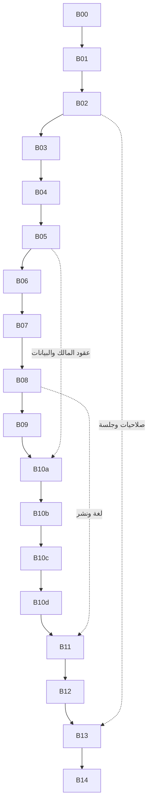

# منارتك — مراجعة مستقلة وخطة تنفيذ مصححة

تاريخ الإصدار: 15 أكتوبر 2026. هذه الخطة المعتمدة للتنفيذ المتسلسل، ومراجعتها الأصلية مثبتة على `5c0f72c`.

> **حالة الاستئناف:** اكتملت B00 وB01–B09 على مستوى المصدر؛ جُلب main وفرع العمل وتأكد تطابقهما عند `93a1c4d1946db9480bd94ca2a3291be34b742c68`. اكتملت B10a وB10b وB10c وB10d على مستوى المصدر بالتسلسل في فرع العمل فقط؛ التالية **B11** (لم تبدأ في هذه الجولة). التشغيل وقاعدة البيانات والنشر ما زالت منفصلة ومعلقة وفق التقارير. المرجع الجاري هو [سجل التنفيذ](ARCHITECTURAL_SECURITY_EXECUTION_STATUS_2026-10-15.json).
>
> **فرع العمل الحالي:** `fix/b02-auth-session-boundary-20261015`. هذه النسخة من الخطة مرفوعة إلى فرع العمل فقط. استكمل عليه، ولا تدفع أو تدمج إلى main إلا بطلب صريح جديد من المستخدم.

اقرأ أيضًا [أحكام البنود الـ49 وأدلتها](../reviews/ARCHITECTURAL_SECURITY_VERIFIED_FINDINGS_2026-10-15.md)، و[تقرير B01](../reviews/B01_SEARCH_ACCESS_BOUNDARY_2026-10-15.md)، و[تقرير B02](../reviews/B02_AUTH_SESSION_BOUNDARY_2026-10-15.md)، و[تقرير B03](../reviews/B03_PUBLIC_LEARNING_CONTAINMENT_2026-10-15.md)، و[تقرير B04](../reviews/B04_OWNERSHIP_ASSET_GOVERNANCE_2026-10-15.md)، و[تقرير B05](../reviews/B05_OWNER_CONTRACTS_DATABASE_PLAN_2026-10-15.md)، و[تقرير B06](../reviews/B06_SCHOLARSHIP_CANONICAL_AUTHORING_2026-10-15.md)، و[تقرير B07](../reviews/B07_ADMIN_NAVIGATION_REVIEW_ASSETS_2026-10-15.md)، و[تقرير B08](../reviews/B08_PUBLIC_DISCOVERY_LOCALE_2026-10-15.md)، و[تقرير B09](../reviews/B09_UNIFIED_WORKER_RUNTIME_2026-10-15.md). الجداول والأعداد التالية تحفظ نتائج المراجعة الأصلية؛ أي تغيير لاحق يُحسم من الكود الحالي وسجل التنفيذ.

تقارير الاستكمال: [B10a](../reviews/B10a_FELLOWSHIP_AUTHORING_2026-10-15.md)، [B10b](../reviews/B10b_UNIVERSITY_STRUCTURE_2026-10-15.md)، [B10c](../reviews/B10c_OWNER_DRAFT_CREATION_2026-10-15.md)، [B10d](../reviews/B10d_COURSE_AUTHORING_2026-10-15.md).

## 1. قراري بشأن التقرير

التقرير مفيد لكشف مواضع حقيقية، لكن لا أوصي بتنفيذ تعليماته كما هي. بعض الاستنتاجات مبني على قراءة جزء من ملف أو مساواة فشل فاحص نصي بفشل المنطق. كذلك تخلط قائمته بين ثغرة وصول، وتعطيل تحرير، وميزة منتج غير مبنية. توجد توصيات قد تسبب تراجعًا: حذف ملف تستخدمه شاشة، تعديل ترحيلات تاريخية، احتساب إجمالي من عينة، وتحميل كل الكتالوجات دفعة واحدة.

تحققت من **جميع البنود المرقمة الـ49** في النسخة المثبتة:

| الحكم | العدد | المعنى |
|---|---:|---|
| مؤكد | 25 | جوهر الملاحظة قائم؛ الخطورة والأثر والإصلاح يعاد ضبطها حسب الدليل. |
| صحيح جزئيًا | 19 | أصل الملاحظة صحيح، لكن يوجد تعميم/أثر غير مثبت/حماية أغفلها التقرير. |
| غير صحيح حاليًا | 4 | الادعاء الأساسي تدحضه الشيفرة الحالية أو اختبار محلي مباشر. |
| مُعالج سابقًا | 1 | الإصلاح قائم على main ويحتاج حماية من التراجع فقط. |

هذه أعداد **ادعاءات التقرير**، وليست 25 ثغرة أمنية مستقلة. لا أصدق وصفه «فحص أمني شامل» أو «كل المراحل مكتملة» من تحليل المصدر وحده. راجعت جدول المراحل كتصريحات عامة؛ لا تمنح هذه المراجعة شهادة قبول لكل متطلب في المراحل الـ24، ولا تحصي كل أخطاء المستودع الممكنة.

## 2. النسخة والأدلة وحدود التحقق

- المستودع: `wegdangamil2022-oss/MANARATAK-First-`.
- أحدث main وقت التثبيت: `5c0f72cf268f4a127d1f9bc64b8af1bccb7fd1eb`، ويتضمن تحديثات القسم 27.
- بدأت المراجعة من النسخة المحلية `aed192c`، ثم جلبت main وراجعت فرق التحديثين الجديدين في worktree منفصل؛ النتائج والأعداد النهائية تخص `5c0f72c`.
- المخطط الفعلي: **278 model، و6065 سطرًا، و103 migration.sql**. التقرير يقول 276/6026/106. عدد model لا يثبت تطابق عدد جداول قاعدة تشغيل حقيقية.
- سجل الملكية: **267 نموذجًا**؛ المفقود **11**. بيانات حوكمة الترحيل ناقصة في **10 ملفات**. سجل مراجع الأصول ينقصه **4 حقول**.
- شغلت **7 فواحص مصدر** وحفظت مخرجاتها وأكواد خروجها. كلها أعادت exit 1؛ بعضها يكشف نقصًا حقيقيًا وبعض شروطها نصية متقادمة. لا يجوز مساواة كل FAIL بثغرة.
- شغلت **35 اختبارًا محليًا خفيفًا في 3 ملفات**: **34 ناجحًا، وواحد فاشل**، خلال نحو 5 ثوانٍ. تشمل اختبارات قائمة للمنح و14 ملاحظة تحقق مستقلة. نجاح اختبارات تصف خللًا يعني أنها أثبتت وجوده، لا أن النظام أصبح آمنًا.
- الفشل القائم يؤكد `REL-05`: الرسالة تفقد `:linkKey`، بينما رفض ربط برنامج بجامعة خاطئة ما زال يعمل.
- لم أتصل بقاعدة بيانات تشغيلية، ولم أفحص جلسات مستخدمين أو أسرارهم، ولم أشغّل workers أو مزودي بريد/دفع، ولم أنفذ اختبار اختراق على الإنتاج، ولم أشغل `npm test` الشامل أو اختبارات ثقيلة.
- الأدلة التفصيلية وروابط الملفات مثبتة على commit محدد في `docs/reviews/ARCHITECTURAL_SECURITY_VERIFIED_FINDINGS_2026-10-15.md`؛ لا تعتمد أرقام أسطر التقرير القديم عند التنفيذ.

## 3. أهم تصحيحات الأحكام

| البند | الحكم الذي نعتمده |
|---|---|
| SEC-01 | وصول مجهول لمساري البحث الداخلي/history مؤكد في تركيب المسارات واختبار HTTP محلي ببدائل. لا ندعي إثبات حجم تسرب الإنتاج أو تسجيل غير محدود؛ يوجد rate limit عام وحدود طلب. |
| SEC-02 | تسريب تشخيص طلبات وIP وإعدادات تشغيلية صحيح؛ المعروض 4 قيم إعداد، لا كل أسرار البيئة. |
| SEC-03 | خلل سياسة CSRF مؤكد؛ SameSite وCORS يحدان من بعض السيناريوهات. الاستغلال عبر متصفح وإعداد نشر فعلي يحتاج تحققًا مستقلًا. |
| SEC-04 | دالة قوة السر تقبل default معروفًا للتطوير؛ لم يثبت أن البيئة الفعلية تستعمله. |
| SEC-07 | غير صحيح لهذا المكون: Markdown لا يولد روابط أو صورًا؛ يعرضها React كنص. اختبار SSR أكد غياب anchor/img وهروب HTML. |
| REL-03 | الإبطال الدلالي للغة موجود ويعمل. الفاحص يرفض صياغة فيها أقواس و`?? null`؛ أصلح الفاحص لا منطقًا سليمًا. |
| FK-03 | توجد قيود FK في ترحيلات SQL للحوكمة؛ النقص في تمثيل Prisma لا يساوي غياب قيد قاعدة البيانات. تطبيق الترحيلات في الإنتاج غير متحقق. |
| A2A-01 | مصدر مراجعة careers موجود مرتين للحالتين الصحيحتين بعد مصفوفة owners. إضافته كما يقترح التقرير تكرر المصدر. |
| ADM-08 | `AIGovernanceOperations.tsx` مستخدم من `AIGovernancePage.tsx`؛ لا يُحذف. الملف القديم لتفاصيل المنحة مرشح تنظيف بعد فحص الاستهلاك الكامل. |
| ADM-06 | `MentorshipSessionRecord` المذكور غير موجود في schema الحالي. الخريجون لهم قراءة API وعرض سجلات، وليس مجرد نص صامت. الإرشاد توسعة منتج لها متطلبات خصوصية. |
| SYNC-02 | اللقطة محدودة فعلًا، لكن متصفحات النطاقات الخمسة تملك تحميلًا من الخادم وصفحات/مؤشرات. لا نعالج هذا بتحميل كل السجلات. نراجع شمول الفلاتر، خصوصًا محلية الجامعات. |
| SYNC-04 | وجهات الدراسة المميزة تستقبل البيانات الحية وحالة العرض بالفعل؛ لا نعيد تنفيذ الإصلاح. |
| SYNC-06 | المحاكي الأكاديمي معزول عن api بعودة مبكرة؛ إنشاء خدمة تقارير حقيقية ميزة لاحقة. |
| SYNC-07 | البيانات التجريبية في fallback موجودة، لكن الإسقاط المنشور يمرر contentSections فتتجاوزها الشاشة عادة، حتى إذا كانت []. نثبت العزل صراحة بدل ادعاء عرضها الحي المؤكد. |
| SYNC-05 | الأرقام الثابتة غير مقبولة؛ عد أول 20 تخصصًا بدلها ليس إجماليًا صحيحًا. يلزم تجميع من المالك أو حذف العدد. |

## 4. فجوات إضافية كشفها التحقق

هذه إضافات محددة من الفواحص/التتبع، وليست ادعاء تدقيق جديد شامل:

| المعرف | الفجوة | الدليل | الحزمة |
|---|---|---|---|
| NEW-01 | ربط اختيار الدولة بالاسم المعروض داخل CountriesSearchPage بدل تخزين ID مباشرة | حارس المصدر و`countries.find(item => item.name === selectedCountryName)` | B08 |
| NEW-02 | ثلاثة scripts تستعمل Prisma دون تصنيف تشغيلي واضح | certificates/verify-isolated-runtime، release/build-immutable-artifacts، release/lib/ReleaseContracts | B04 |
| NEW-03 | فاحص P3 يفشل في حفظ requestedCanonicalId بسبب regex لا يقبل الأسطر الجديدة رغم وجود fallback كامل في UI | `ScholarshipImportCenterPage.tsx` يحتفظ rawValue ثم requestedCanonicalId ثم canonicalId؛ راجع شرط السطر 83 من الفاحص | B04 |
| NEW-04 | خيار `exemptBearerAuth:false` لا يطبق؛ المرور يتم بمجرد وجود Bearer header | اختبار guard محلي؛ المتغير محسوب لكنه غير مستخدم في الشرط | B02 |
| NEW-05 | حقل `StudentApplicationDocumentBinding.assetId` الجديد غير مسجل في manifest ولا في usage registry ولا يملك relation إلى Asset في schema | اختبار gateway ببديل يحاكي مرجعًا وحيدًا أعاد usages فارغة؛ ليس اختبار حذف فعلي | B04 |

النماذج الـ11 المفقودة: `AssetRenditionRecord`, `AuditAlertOccurrenceRecord`, `AuditWorkspaceRecord`, `CertificateAuthorityDelegation`, `OwnerTranslationTransferReceipt`, `SettingsGovernanceRecord`, `StudentApplicationDocumentBinding`, `StudentSupportOwnerReadObservation`, `UniversityProgramIntake`, `UniversityProgramStudyLanguage`, `UniversityProgramStudyProfile`.

## 5. كيف نمنع تعارض الحزم

لا يمكن ضمان أن تغييرًا لن يؤثر مطلقًا في أي جزء آخر. الطريقة العملية هي تثبيت العقود، وتقليل مساحة كل تغيير، والتحقق من المستهلكين قبل الدمج. نعتمد تنفيذًا **متسلسلًا افتراضيًا** للحزم الآتية، وتجزئة الحزمة الكبيرة إلى تغييرات صغيرة قابلة للتراجع. لا نبدأ حزمة تكتب نفس الملفات قبل إغلاق سابقتها.

1. لكل حزمة commit/PR مستقل، وصاحب نطاق واحد، وملفات متوقعة، وعقد دخول وخروج، ودليل اختبارات. تحديث main وإعادة فحص الفرق قبل البدء وقبل الدمج؛ لا overwrites لتغييرات القسم 27.
2. ملفات التنسيق المشتركة ذات حجز تغيير متسلسل: `app.ts`, `AuthRouter.ts`, `container.ts`, admin `App.tsx`, web `PublicTemplateApp.tsx`, API clients، DTOs، `schema.prisma`، manifests، وقواعد publication. لا نجمع تعديلين مستقلين عليها في وقت واحد.
3. تعديل contract أولًا، ثم المالك/الخادم، ثم العميل، ثم إزالة التوافق في حزمة لاحقة. كل consumer معلوم يدخل اختبار التغيير. أي breaking API يقسم expand/migrate/contract.
4. قاعدتا البلد ووجهة الدراسة تبقيان بمالكيهما الحاليين: المرجع الجغرافي canonical في reference، ومحتوى وجهة الدراسة واعتمادها في owner مستقل. لا ننقل المحتوى إلى ReferenceCountry لتبسيط الواجهة.
5. لا تعديل ترحيل تاريخي مطبق؛ حتى تغيير التعليقات يغير checksum. أي تغيير بنيوي مضاف وموثق بعد جرد القيود والبيانات. لا `db push` ولا reset ولا backfill تخميني.
6. لا نحول حالة منشور/معتمد إلى مجرد boolean محلي، ولا نعطل freshness/independent reviewer/approvalHash؛ نحافظ على إصلاحات القسمين 12 و16.
7. لا توسعة manifest allowlist لإخفاء قراءة عابرة للمالك، ولا إضعاف assertions لجعل الفحص أخضر. كل تصحيح لفاحص متقادم يرتبط باختبار سلوك بديل مثبت.
8. حالة source-verified منفصلة عن isolated-runtime-verified وعن deployed. إغلاق بند مصدر لا يعني السماح بترحيله للإنتاج.

## 6. ترتيب التنفيذ المعتمد

تقدير الحجم نسبي: صغير = تغيير محدود؛ متوسط = عدة طبقات بعقد معروف؛ كبير = يجزأ إلزاميًا. لا أضع مواعيد ساعات قبل تثبيت النطاق وفحص البيانات. رموز B هنا تخص هذا الإصدار من الخطة؛ لا تساوي مراحل المعمارية P01–P24 ولا أرقام أقسام مراجعة الإدارة.

| الترتيب | الحزمة | الاعتماد المباشر | الحجم | المخرج |
|---|---|---|---|---|
| B00 | تثبيت baseline وسجل الديون | لا شيء؛ تم للمراجعة الحالية | صغير | نسخة commit + أحكام + logs قابلة للتكرار |
| B01 | إغلاق البحث الداخلي والتشخيص العام | B00 | متوسط | فصل public search وحماية الداخلي والتاريخ |
| B02 | الجلسات وCSRF والمصادقة والأسرار | B01 | متوسط/كبير | عقد جلسة واحد بين API وweb/admin وDI صارم |
| B03 | احتواء مسار التعلم والادعاءات الوهمية | B02 | صغير/متوسط | learner فعلي؛ لا بطاقات/أرقام وهمية في api |
| B04 | حوكمة الملكية والأصول والفواحص | B03 | متوسط | manifests صحيحة وpurge واعٍ بالمراجع وmetadata آمنة |
| B05 | عقود المالك ومراجعة SQL وخطة البيانات | B04 | متوسط/كبير | عقود canonical مستقرة وخطة expand مع أدلة قيود |
| B06 | محرر المنح والفلاتر والـpickers | B05 | متوسط | تحرير canonical دون فقد المراجع؛ أخطاء مستقرة |
| B07 | التنقل والإدارة ومصادر المراجعة | B06 | متوسط | روابط واكتشاف داخلي بصلاحيات ومعرفات صحيحة |
| B08 | الاكتشاف العام واللغة والبيانات الحية | B07 | متوسط/كبير | صفحات خادم صحيحة وfeatured/بحث/تحديث دون truncation دلالي |
| B09 | توحيد workers وعقد التشغيل | B08 | متوسط | host/lease/retry/drain مثبتة قبل توسعات تشغيلية |
| B10a–d | استكمال قدرات المالكين | B05–B09؛ واحدة تلو الأخرى | كبير مجزأ | زمالات، حرم، إنشاء مسودات، تأليف دورات |
| B11 | ترجمة الأوصاف والنطاقات الإضافية | B10 للحقول الجديدة + B08 | متوسط | ترجمة مالك معتمدة لا overlay محتوى موازٍ |
| B12 | الإرشاد المهني وسياسة الخريجين | B09 + عقود B10/B11 ذات الصلة | كبير/نطاق منتج | جلسات وسياسة consent أو قرار عدم إدراج موثق |
| B13 | عمليات المالية المتقدمة | B02 + B09 + B10d | كبير مجزأ | إجراءات مالية مدققة ومحصنة ضد التكرار |
| B14 | مصالحة نهائية وتوثيق جاهزية الإصدار | جميع الحزم الداخلة في نطاق الإصدار | متوسط | source gate ثم runtime gate منفصل |



الرسم يبين التسلسل الافتراضي وعقودًا مهمة إضافية، وليس إذنًا لتنفيذ branches متزامنة. ميزات المنتج لا تمنع إصدار إصلاحات B01–B04 مبكرًا إذا اجتازت تحققها؛ لا ننتظر بناء المالية والزمالات لإغلاق وصول عام خطر.

## 7. بطاقات الحزم: النطاق والقبول والتراجع

### B01 — حدود الوصول للبحث والتشخيص

- **يغطي:** SEC-01، الجزء القائم من SEC-02. **الملفات:** SearchRouter، تركيب app، منافذ البحث/history وسياسة الصلاحيات، إزالة تسجيل diagnosticsList من SecurityMiddlewareFactory.
- **التنفيذ:** فصل GET `/search/public` عن execution/history؛ مصادقة صحيحة وصلاحية محددة ومجال وصول للتاريخ مرتبط بالفاعل/السياق. لا نعتمد اسم reference كإذن. لا نفرض admin permission شاملة على البحث العام. إزالة endpoint التشخيص والـglobal payload، مع بديل رصد منقح إن احتاجه التشغيل.
- **القبول الخفيف:** public published search ينجح؛ المجهول للداخلي 401؛ ذو صلاحية ناقصة 403؛ فاعل لا يرى history غير مسموح له؛ المرجع غير الصالح 400؛ التشخيص 404 أو استجابة مقيدة منقحة. اختبار يجمع mount الفعلي مع guard، لا Router معزول وحده بعد الإصلاح.
- **التراجع:** تراجع الميزة الداخلية خلف disable switch إذا تعطل مستهلك شرعي؛ لا إعادة فتحها للعامة أو إعادة payload المشترك. **الخروج:** حدود وصول مثبتة وأسماء consumers المحولين موثقة.

### B02 — عقد جلسة موحد وتبعيات auth صريحة

- **يغطي:** SEC-03/04/05/06، ARCH-05، NEW-04. **الملفات:** AuthRouter، SecurityMiddlewareFactory، HttpOnlyAuthCookies، container، config validators، web/admin clients.
- **الترتيب الداخلي:** توثيق credential modes وتدفق CSRF bootstrap/refresh؛ تحديث clients؛ تطبيق guard المطابق تمامًا للمسار بعد التطبيع؛ إغلاق access-cookie-only ومعالجة bearer بناء على وضع المصادقة الموثوق؛ سياسة أسرار مشتركة؛ نقل البناء إلى DI؛ ميزانيات المسارات الأربع وحماية تعداد الحساب.
- **الحدود:** لا تغيير تنسيق كلمة المرور أو مدد الرموز أو cookies دون حاجة مثبتة. لا startsWith/includes/endsWith للاستثناءات. لا اعتبار Bearer string وحده إثبات مصادقة. نموذج ذاكرة متاح عبر fixtures لا fallback في production-like.
- **القبول الخفيف:** login→bootstrap→mutation→refresh→logout على عميلَي الويب والإدارة ببدائل؛ token ناقص/خاطئ/جلسة أخرى يرفض؛ المسار المضمّن نصيًا لا يستثنى؛ access-only لا يمر بلا حماية؛ bearer=false يطبق؛ الافتراضي المعروف يرفضه كلا validators؛ production DI الناقص يفشل مبكرًا؛ budgets مستقلة مع responses متوافقة.
- **التراجع:** إصدار API/client متوافق أو احتواء mutations المتأثرة مؤقتًا؛ لا إرجاع bypass. **الخروج:** مصفوفة المسار×credential×client خضراء، وWP8 reconciliation خالٍ من اقتران AuthRouter.

### B03 — احتواء بيانات النموذج ومسار تعلم الدورة

- **يغطي:** SYNC-01/03/05، أجزاء التشغيلية من SYNC-09. **الملفات:** PublicTemplateApp، FeaturedScholarships/Majors/Exams/AIToolsBanner وعقد navigation learner عند الحاجة.
- **التنفيذ:** وصل CTA تعلم الدورة بالمسار الحقيقي عبر ownerId وعقد التطبيق المحلي، مع auth intent وحالة enrollment. الغرفة التجريبية لا تستعمل في api. البطاقات والأعداد غير الموثقة تخفى/تظهر عدم توفر حتى تصل عقود B08؛ لا نختلق بيانات بديلة.
- **القبول الخفيف:** دورتان بمعرفين مختلفين تنتقلان للمالك الصحيح؛ غير المسجل له مسار دخول/عودة؛ استحقاق مدفوع يتحقق على الخادم؛ لا تمرير تقدم/نتيجة/شهادة من النموذج؛ api الفارغ لا يعرض mockCards أو أعدادًا ثابتة. الحفاظ على prototype صريح إذا بقي مطلوبًا.
- **التراجع:** تعطيل CTA أو عنصر featured المعطل فقط. **الخروج:** لا ادعاءات تعليم أو أرقام حية من مصدر تجريبي في الفروع المعدلة.

### B04 — ملكية البيانات والأصول والفواحص الصادقة

- **يغطي:** ARCH-01/02/04/06، REL-03، NEW-02/03/05. **الملفات:** manifests، DTO import، usage registry/readiness، سياسات operational tooling، الفاحصان النصيان المذكوران.
- **الترتيب:** تثبيت model→owner والـasset fields الحالية، ومراجعة ملكية receipt؛ إضافة مرجع وثيقة الطالب إلى usage/retention وعدم تكرار الثلاثة الموجودة؛ تصنيف scripts بحسب purpose/read/write/env/gate؛ معالجة metadata الترحيل وفق applied/unapplied؛ نقل DTO؛ استبدال الشروط المتقادمة بتحقق غير حساس للتنسيق أو سلوكي.
- **القبول الخفيف:** كل model وasset field مسجل مرة لمالكه الصحيح؛ gateway يحسب المرجع الرابع؛ purge مرفوض عندما binding هو المرجع الوحيد، مع حالات unlink/expiry وفق retention؛ حارس DTO بلا Application bypass؛ scripts مصنفة بقيود حقيقية. اختبارات اختلاف لغة المنحة وثباتها والتعديل غير المرتبط، وحفظ requestedCanonicalId بلا rawValue.
- **حد الترحيلات:** لغياب حالة قاعدة فعلية نجهز inventory وmetadata وفق الآلية التاريخية المعتمدة؛ لا نزعم اكتمال applied audit. لا تغيير checksum تاريخي لجعل الفاحص PASS.
- **التراجع:** استرجاع عقد DTO/manifest المتوافق؛ إيقاف purge عند عدم اليقين، لا إعادة تجاهل مرجع معروف. **الخروج:** فاحص الأصول ناجح، وغياب مخالفات ownership/header/operational/DTO المنسوبة لهذه الحزمة. القراءة العابرة في ARCH-03 معلقة لـB05، وNEW-01 لـB08؛ لا ندعي اخضرار جميع الفواحص قبل ذلك.

### B05 — تثبيت عقود المالك وقرار FK دون مخاطرة بيانات

- **يغطي:** ARCH-03، FK-01..04. **الملفات:** owner read ports، adapters المنح/الجامعات، DTOs المعتمدة، schema وSQL inventory؛ migration إضافي فقط إذا بررته الأدلة.
- **الترتيب:** منفذ قراءة البرامج يحدد ID/parent/degree/publication والحدود؛ توحيد استخدامه عبر consumers؛ جرد قيود SQL الموجودة؛ قرار موثق للحقل القديم للعملة وISO defaults ودولة الخدمة؛ تصميم expand ومراقبة الأيتام والازدواج والتوافق.
- **القبول الخفيف:** برنامج لجامعة أخرى وغير منشور/درجة غير مطابقة يرفض؛ لا ORM عابر غير معتمد؛ consumer لا يقرأ جداول المالك مباشرة. تحليل مخطط/SQL يثبت عدم تكرار FK أو كسر immutable triggers؛ validate من المخطط دون اتصال، واختبارات منافذ ببدائل. بيانات غامضة تبقى unresolved ولا تربط بالاسم.
- **قبل تطبيق DB لاحقًا:** snapshot إحصائي read-only من البيئة المقصودة، checksum/application status، خطة أيتام مع قرار مالك، rehearsal في قاعدة معزولة وخطة استعادة. ليست إجراءات نُفذت في هذه المراجعة.
- **التراجع:** يبقى حقل التوافق القديم أثناء expand؛ إيقاف استخدام الحقل الجديد دون DROP أو down migration يخسر البيانات. **الخروج:** عقد إصدار ثابت يستهلكه B06، وفاحص persistence ينجح بعد استيفاء B04؛ إعلان source-only إن لم يتوفر إثبات قاعدة معزولة.

### B06 — محرر المنح والـpickers دون فقد المعرفات

- **يغطي:** REL-01/02/04/05. **الملفات:** CatalogDetail/RelationshipEditor/List، canonicalPickers/CanonicalPicker، API والعقد الذي ثُبّت في B05، خطأ برنامج الجامعة في UseCase.
- **التنفيذ:** عرض canonical IDs مع labels كمعلومات مصدر مستقلة؛ توحيد واجهة العلاقات بدل حفظ null من اقتراح نصي؛ استكمال الفلاتر المعيارية الموجودة وإزالة خيارات العلاقات النصية المكررة بتوافق معلوم؛ تمرير query/page خلال loaders؛ حفظ الاختيار غير المحمل؛ error suffix دون إضعاف parent policy.
- **القبول الخفيف:** اختيار دولة/تخصص بعد العنصر 100 عبر بحث وصفحات؛ اختيار قائم خارج الصفحة لا يختفي؛ مرجع inactive يعرض وغير قابل لاختيار جديد حسب سياسة المالك؛ إعادة حفظ حقل وصفي تحفظ degree/major/language IDs؛ تبديل source label يبطل الربط فقط عندما يلزم؛ فلاتر ID لا تطابق اسمًا مشابهًا؛ نشر غير مكتمل يظل مرفوضًا؛ اختبار REL-05 القائم ينجح.
- **التراجع:** شاشة العلاقات القائمة تبقى متاحة حتى تعادل قدرات المحرر؛ لا تبديل جماعي لمعرفات البيانات. **الخروج:** فواحص P3 وWP12.9 وP9 ناجحة بعد تصحيح شروطها المتقادمة، واختبارات owner/UI المحددة ناجحة.

### B07 — التنقل وطابور المراجعة وروابط الأصول

- **يغطي:** A2A-02/03/04/05/07/08، ADM-04؛ حماية A2A-01 القائم. **الملفات:** routes/navigation، Import/University/Scholarship pages، ReviewSources، auditTargetLink، AssetGovernancePanel، CareerAdminPage.
- **التنفيذ:** خريطة typed للمسار والpermission ونوع ID؛ إصلاح كل روابط basename دون تغيير API endpoint strings؛ ربط الجامعة بتفاصيلها؛ مصدر وجهة دراسة وفق status/profile ID الحقيقي؛ careers الموجود لا يكرر؛ AssetPicker والشريط المرجعي بصلاحياتهما.
- **القبول الخفيف:** MemoryRouter بعنوان basename مناسب يفتح الصفحة المطلوبة دون fallback dashboard؛ ممنوع الصلاحية لا يرى الرابط ولا يصل لعملية محمية؛ عدادات/صفحات مراجعة ببدائل لكل حالة؛ country ISO/profileUUID/ownerUUID لا يتبادلون؛ لا URL لتفاصيل غير موجودة؛ لا عرض metadata خاصة في روابط الأصول.
- **التراجع:** إبقاء قائمة النطاق مصدر الوصول عند تعطل تفاصيل؛ لا اختراع alias شامل يخفي الأخطاء. **الخروج:** مصفوفة الروابط والـpermissions مغطاة واختبارات careers لا تتضاعف نتائجها.

### B08 — اكتشاف عام شامل المعنى ومحدود التحميل

- **يغطي:** SYNC-02/03/05/08/09، NEW-01؛ حراسة SYNC-04/06/07. **الملفات:** publicLiveDataSource/usePublicLiveData، متصفحات النطاقات، SmartSearch، مكونات featured، PublicTemplateApp والعملاء.
- **التنفيذ:** snapshot معاينة محدود؛ query/pagination/filters من مالك كل كتالوج؛ تمرير locale في التحميل الأول والتحديث، cache key/abort/generation منسجمة مع اللغة؛ careers إما refresh حيث يلزم أو استبعاد اللقطة غير المستهلكة؛ featured منشور وروابط ID؛ count إجمالي من owner aggregation أو حذف العدد؛ اختيار دولة يخزن canonical ID مباشرة. البحث العام يستعمل العقد القائم `GET /api/v1/search/public` الفعلي ولا ينشئ محركًا موازيًا.
- **محتوى FAQ والسياسات:** فرز النص الثابت المعتمد عن الوعود التشغيلية. إذا أريد تحريره عبر CMS نثبت route/client ونوع المحتوى واللغة والنشر أولًا؛ لا ننفذ URL المقترح لمجرد وروده بالتقرير. أي invalidate له عقد SLA معلوم؛ لا وعد بأن الإدارة تنعكس «فورًا» دون تعريف cache/refresh.
- **القبول الخفيف:** العنصر 26/51/101 يمكن العثور عليه والانتقال إليه دون تنزيل الكتالوج كاملًا؛ فلتر الدولة أو الدرجة المطلوب شامل لا يرشح الصفحة الحالية فقط؛ الصفحة التالية تحافظ على الفلتر واللغة؛ استجابة لغة قديمة لا تستبدل الجديدة؛ empty/error بلا prototype؛ published-only وapproval/freshness قائم؛ بطاقة رئيسية لا تستعمل بيانات تفاصيل خاصة بالجلسة؛ تجميع counts لا يساوي طول العينة.
- **التراجع:** تعطيل block متضرر مع إبقاء البحث والروابط الأساسية؛ إعادة cursor/client المتوافق لا all-pages preload. **الخروج:** لا name-based-relation في NEW-01، وكل حالات الاكتشاف واللغة المعدلة ناجحة؛ الفواحص المعمارية مجتمعة خضراء على نطاق baseline المحدث.

### B09 — مشغل خلفي واحد ودليل تشغيل

- **يغطي:** ARCH-07. **الملفات:** PollingWorkerRuntime/Bootstrapper، server وcomposition root، contracts ونشر worker حسب host الفعلي.
- **التنفيذ:** جرد job→host→schedule→lease→retry→DLQ→shutdown؛ توحيد التسجيل وإزالة dead import بعد إثبات التكافؤ. استضافة HTTP serverless لا تشغل setInterval جديدًا لكل request؛ الاختيار بين worker دائم أو cron/queue مؤمن حسب بيئة نشر مثبتة.
- **القبول الخفيف:** fake timers وبدائل تثبت lease/renewal، تنازع عاملين، dedup، retry، stop/drain؛ health يفرق غياب worker عن صحة HTTP. لا إرسال إشعارات أو إصدار شهادات حقيقية أثناء الفحص.
- **التراجع:** واحد فقط من host القديم/الجديد يملك lease؛ إيقاف الجديد أولًا دون تشغيل مزدوج. **الخروج:** خطة تشغيل وعدادات مراقبة ومسؤول scheduler واضحة؛ تشغيل host نفسه يحتاج دليل runtime معزول قبل وصفه نشطًا.

### B10a–d — نواقص قدرات المالكين، أربع حزم مستقلة

**إغلاق المصدر الحالي:** B10a–B10d مكتملة على فرع العمل؛ تقاريرها ومواصفاتها وسجل الفحوص أعلاه. لا DB rehearsal أو نشر من إغلاق المصدر.

**قاعدة الدخول:** وجود جدول لا يحدد تجربة المنتج أو حق الحذف. تنتج كل حزمة specification قصيرًا يحدد المالك والدورة والحالات وAPI وRBAC والأثر العام قبل كتابة UI. كل واحدة تسلم وحدها ولا نبدأ التالية قبل إغلاقها.

| الحزمة | النطاق | قبول خفيف جوهري | التراجع |
|---|---|---|---|
| B10a — ADM-01 / SYNC-07 | زمالات تحت عقد majors القائم؛ تعريف profile/requirements/benefits ومراجعة ونشر، ثم API وإدارة وعرض منشور | مسودة غير ظاهرة للعامة، تغيير علاقات يقتضي إعادة اعتماد، لا demo IDs، نشر ثم unpublish يعكس الإسقاط | إخفاء editor/consumer الجديد؛ إبقاء السجلات وإصداراتها |
| B10b — ADM-02 | إدارة campuses/organizationUnits باستخدام aggregate الجامعة الموجود | parent صحيح، optimistic concurrency، لا حذف وحدة عليها برنامج، القوائم والبرامج ترى نفس owner ID | تعطيل إجراءات جديدة، لا cascade |
| B10c — ADM-03 | إنشاء مسودات منحة/جامعة/تخصص عبر API المالك؛ سياسة DegreeLevel المعياري مستقلة | RBAC، dedup، مصدر إنشاء واضح، لا publish عند create؛ مراجعة إنشاء الدرجة إن كان مطلوبًا في المنتج | إخفاء زر الإنشاء دون حذف المسودات |
| B10d — ADM-05 | بنوك أسئلة ثم learning paths ثم ترتيب/إزالة عناصر مسودة؛ حماية المنشور وتقدم الطلاب | reorder يحفظ IDs، محاولتان متزامنتان لا تفسدان الترتيب، حذف منشور/مرتبط يرفض أو يتقاعد وفق السياسة | إبقاء published version؛ إيقاف authoring الجديد |

أي schema جديد يعيد فتح B04 لملكيته ومراجع أصوله وmetadata، ثم B05 لتوافقه؛ هذا checkpoint معروف وليس مفاجأة في مرحلة لاحقة. لا ننشئ Fellowship store موازيًا ولا شاشات CRUD عامة تتجاوز UseCases.

### B11 — ترجمة مالك لا مجرد تبديل supportsDescriptions

- **يغطي:** A2A-06. **الملفات:** capabilities/DTO، owner translation UseCases/gateways/receipt، TranslationWorkspace، public locale projection.
- **التنفيذ:** لكل نطاق ندقق حقول المصدر واللغات وحالة المراجعة والصلاحية وsnapshot linkage؛ نضيف الأوصاف والوجهات/الخدمات/الوظائف تباعًا فقط بعد قبول المالك لها. reuse receipt وعقود الترجمة الحالية.
- **القبول الخفيف:** تعديل مصدر بعد الترجمة يجعل القديم يحتاج مراجعة؛ وصف draft لا ينشر؛ تغيير اللغة لا يخلط snapshots؛ نص فارغ لا ينسخ محتوى وهميًا؛ عنوان ووصف مرتبطان بنفس owner/version؛ import retry لا يكرر التسليم.
- **التراجع:** تعطيل capability الجديدة لا حذف ترجمة قائمة. **الخروج:** مصفوفة owner×fields×locale×review×public reader، مع دليل لكل supportsDescriptions=true.

### B12 — الإرشاد والخريجون حسب سياسة منتج واضحة

- **يغطي:** الجزء الفعلي من ADM-06. **الدخول:** تعريف الإرشاد: الأطراف، الحجز، الموافقة، الإلغاء، الظهور، retention. لا نبني CRUD لجدول MentorshipSessionRecord متخيل.
- **التنفيذ:** توسيع careers عبر مالكه وعقوده وRBAC وموافقات المستخدمين، ثم الإدارة والواجهة المسموحة. الخريجون الحاليون قراءة consent؛ لا إضافة صلاحية تعديل لهم دون سياسة موثقة.
- **القبول الخفيف:** جلسة لا تظهر لغير أطرافها/صاحب الإذن؛ إلغاء/إعادة محاولة لا تحجز موعدًا مرتين؛ سحب موافقة يوقف الظهور؛ سجل تدقيق لا يسرب بيانات خاصة.
- **التراجع:** تعطيل الحجز الجديد والحفاظ على الالتزامات القائمة والقراءة المسموحة. **الخروج:** ميزة متفق على سلوكها، أو قرار نطاق صريح بأنها ليست ضمن الإصدار؛ لا تُحسب ثغرة معالجة بمجرد إضافة جدول.

### B13 — المالية المتقدمة بعد استقرار التشغيل

- **يغطي:** ADM-07. **الملفات:** المالية UseCases/Router/permissions وFinance pages فقط؛ أي أثر على ledger عقد مالك واضح.
- **التقسيم:** قراءة الحسابات أولًا؛ تقسيط الفاتورة؛ إشعار دائن؛ wallet hold/release/capture؛ عكس قيد. كل إجراء PR/قبول منفصل. العمليات ذات الموافقة تستخدم maker/checker حيث تقتضي السياسة، وidempotency ومخزن دائم وoutbox؛ لا تغيير قواعد ledger من UI.
- **القبول الخفيف:** بدائل تختبر تكرار نفس request key، تعارض إصدار، permission، تجاوز رصيد/عملة، ترتيب الفاتورة، وعكس القيد مرة واحدة بسجل معاكس append-only؛ لا حذف/تعديل قيد مالي سابق. اختبار الخدمة الواحدة لا يكفي لإعلان جاهزية بوابة دفع حقيقية.
- **التراجع:** تعطيل إجراء جديد دون محو قيد؛ أي تصحيح مالي بحدث/قيد معاكس مدقق. **الخروج:** عقود واختبارات سلبية لكل عملية، وخطة runtime معزولة قبل السماح بتأثير مالي حقيقي.

### B14 — بوابة الإغلاق وتحديث الوثائق

- **يغطي:** ARCH-08 وADM-08 والمصالحة لجميع البنود. **الملفات:** خارطة الطريق، سجلات closure، tracker الحالي، أدوات التحقق، تنظيف الملف القديم إن ثبت انعدام استعماله.
- **القبول:** كل معرف له نتيجة/commit/دليل أو قرار منتج معلل؛ لا بند يغلق بتعليق؛ لا حذف AIGovernanceOperations؛ تحديث source مقابل runtime مقابل production لكل مرحلة P01–P24، مع بقاء حالات deferred الحقيقية واضحة.
- **بوابة المصدر الخفيفة:** الأوامر السبعة في القسم التالي، اختبارات موجهة للملفات المتغيرة، typecheck للحزم المتأثرة وlint محدود. بعد B08 يجب ألا نحتفظ بفشل قديم معروف مما غطته الخطة، ولا نعيد تشغيل مجموعة ضخمة بعد كل سطر.
- **بوابة runtime منفصلة:** migrations في قاعدة اختبار معزولة، جلسة browser→API→DB، approval/publication/unpublish، workers، purge، استعادة، وسيناريوهات مالية ببيئة مزود اختبار. تحدد مسبقًا عند التنفيذ ولا تشغل ضمن جولة المصدر الخفيفة الحالية. غيابها يبقي حالة runtime pending، ولا يسوغ كتابة production ready.
- **التراجع:** خطة إصدار لكل منطقة تغيرت؛ لا إعادة فتح وصول عام خطر لنجاح smoke، ولا rollback قاعدة بخسارة بيانات.

## 8. الفحوص وإدارة الديون الحالية

أوامر المصدر التي شُغلت في المراجعة الأصلية؛ ملخص نتائجها محفوظ أدناه، وأدلة المصدر في سجل الأحكام المرتبط أعلاه:

```bash
node scripts/architecture/verify-persistence-boundaries.mjs
node scripts/architecture/verify-asset-reference-integrity.mjs
node scripts/architecture/verify-source-architecture-guards.mjs
node scripts/verify-wp8-final-reconciliation.mjs
node scripts/verify-p3-canonical-backbone.mjs
node scripts/verify-wp12-9-scholarship-catalog-detail-source.mjs
node scripts/verify-p9-plan-closure.mjs
```

| الفاحص | خط الأساس الحالي | حزم الإغلاق |
|---|---|---|
| persistence | 33 مخالفة: فرق العدد، قراءتان غير معتمدتين، 30 نقص metadata في 10 ملفات | B04+B05 |
| asset references | 4 حقول مفقودة من manifest | B04 |
| source architecture | 5 مخالفات: DTO، name-based، 3 scripts | B04+B08 |
| WP8 reconciliation | اقتران AuthRouter بالبنية التحتية/Prisma | B02 |
| P3 canonical | 54/57؛ فلتران قديمان + false negative بسبب whitespace في UI | B04+B06 |
| scholarship catalog source | false negative أول عند language assignment، ويجب إعادة تقييم بقية assertions بعد إصلاح الشرط | B04 ثم B06 |
| P9 closure | 96/97؛ عقد suffix في REL-05 | B06 |

لا نفرض نجاح جميع هذه الفواحص بعد B01 كما في التقرير الأصلي؛ أسباب قديمة تقع في حزم لاحقة. نسجل baseline معروفًا ونمنع زيادة المخالفات بعد كل حزمة، ثم نغلق ما تملكه الحزمة بدليل. هذا ليس إعفاءً دائمًا: لا إعلان مصالحة معمارية نهائية قبل اخضرار جميع ما غطته الخطة. إذا اكتشف verifier متوقف عند أول خطأ مشاكل أخرى، تضاف بمعرف ومالك وحزمة قبل الإغلاق، ولا نخفيها.

## 9. تعليمات جاهزة لجولة التنفيذ التالية

> افتح فرع العمل المحدد أعلاه واقرأ الخطة وسجل التنفيذ وتقارير الحزم المكتملة، ثم تحقق من أحدث commit على الفرع والفرق عن main دون محو أعمال أحدث. ابدأ بالحزمة التالية غير المكتملة في سجل التنفيذ؛ بحسب تحديث سجل التنفيذ أصبحت B11. أكمل تنفيذها ومعايير قبولها باختبارات خفيفة، وحدّث سجل التنفيذ وتقرير الحزمة ثم ثبّت التغيير على فرع العمل. لا تعِد B01/B02/B03/B04/B05/B06/B07/B08/B09/B10a/B10b/B10c/B10d إلا عند وجود تراجع مثبت. لا اختبارات ثقيلة، ولا اتصال ببيانات/بريد/دفع حقيقي، ولا تعديل ترحيل تاريخي، ولا إعلان جاهزية إنتاج من source فقط. لا تدفع أو تدمج إلى main إلا بطلب صريح جديد من المستخدم. إذا احتاج النطاق قرار منتج أو بيانات غير متاحة، أكمل التصميم والعقد وdry-run القابلين للمراجعة وسجل المتبقي بدقة؛ لا تخمن IDs أو قواعد موافقة.

سجل الأحكام في [ARCHITECTURAL_SECURITY_VERIFIED_FINDINGS_2026-10-15.md](../reviews/ARCHITECTURAL_SECURITY_VERIFIED_FINDINGS_2026-10-15.md)، وحالة التقدم في [سجل التنفيذ](ARCHITECTURAL_SECURITY_EXECUTION_STATUS_2026-10-15.json). أدلة الاختبارات التفصيلية للحزم ترتبط بتقاريرها. نتائج مراجعة المصدر القديمة لا تلغي الإصلاحات التي دخلت بعد خط أساسها.
