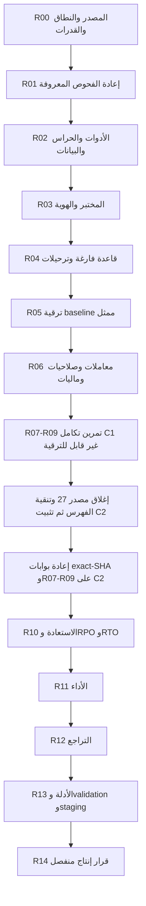

# منارتك — خطة الاختبارات وقاعدة البيانات والقبول التشغيلي بعد القسم 28

**الإصدار:** 1.3 — 16 أكتوبر 2026؛ مبني على v1.2 (16 أكتوبر 2026)، v1.1 (16 أكتوبر 2026) وv1.0 (15 أكتوبر 2026). **الحالة:** خطة تنفيذ وقبول علاقات مع بروتوكول توقف إلزامي عند الخطأ وتسليم الإصلاح يدويًا من Luna إلى Sol؛ لا نتيجة اختبار ولا موافقة نشر.

**القرار:** نبدأ بتثبيت النطاق وإعادة الفحوص المحددة التي لم تُعد، ثم تجهيز أدوات الاختبار والعزل، ثم الترحيلات على قاعدة فارغة وقاعدة ترقية ممثلة، ثم إثبات المعاملات والصلاحيات، ثم إصدار مبني وتشغيل متكامل، فالاستعادة والأداء والتراجع، وأخيرًا مراجعة أدلة الإصدار. لا نبدأ بقاعدة إنتاج، ولا باختبار شامل غير مضبوط، ولا بتشغيل promotion لإظهار ما ينقص.

### ما الجديد في v1.3 — توقّف Luna عند أول خطأ وتسليم الإصلاح إلى Sol

> **قاعدة ملزمة وفورية لكل مراحل R00–R14:** `GPT-6 Luna` مخصص للاكتشاف/التشغيل المصرح/تجميع الأدلة **فقط**. عند **أول خطأ غير متوقع، أو فشل اختبار إلزامي، أو حالة BLOCKED مؤثرة، أو تعارض عقد/بيئة/أمان**، يُوقف Luna التنفيذ فورًا، **ولا يصلح أي ملف أو اختبار أو إعداد ولا يعيد المحاولة ولا يتخطى الخطأ ولا يكمل مراحل مستقلة**. يسلّم **بطاقة توقف** بما ثبت قبل التوقف ويطلب من المستخدم **تغيير النموذج يدويًا إلى `GPT-6.1 Sol — Medium`**. لا يوجد تبديل تلقائي للنموذج. بعد الإصلاح المصرح به واختباره بواسطة Sol، يجب أن **يختار المستخدم Luna يدويًا مرة أخرى** ويأمره بالاستئناف من نقطة التوقف، لا من البداية ولا من موضع يفترض النجاح. انظر **القسم 13.3** للنص التنفيذي الكامل.

- **لا استثناء للإصلاحات البسيطة:** حتى فشل الاختبار الصغير لا يعالجه Luna؛ Sol وحده يُكلَّف بالإصلاح عند انتقال المستخدم إليه.
- **لا تغيير في الحوكمة:** نقص بيانات اعتماد أو بيئة أو قرار معماري قد يوقف العمل لكنه ليس بالضرورة عيب كود يمكن لـSol إصلاحه؛ Sol يشرح المتطلب ولا يتجاوز الصلاحيات. فشل متوقع ومثبت داخل اختبار سلبي ناجح لا يعد خطأً يستوجب التوقف.
- **بقاء المحتوى:** جميع متطلبات v1.2 ومصفوفة العلاقات والاختبارات والبوابات محفوظة؛ تغير فقط *من يُجري الإصلاح ومتى يتوقف العمل*، دون تقليل الاختبارات أو تخفيف شروط القبول.

### ما الجديد في v1.2 — ترشيد استهلاك Codex دون تخفيف القبول

- **إضافة القسم 13 (دليل التشغيل بالنماذج):** توزيع واضح لكل مرحلة R00–R14 بين `GPT-6 Luna` و`GPT-6.1 Sol`، مع قواعد تصعيد وتسليم وتوثيق وتسلسل يبدأ بـR00/الجزء الخفيف من R01.
- **حماية الحصة الأسبوعية والخمس ساعات:** Luna للقراءة والفحوص والتقارير والاختبارات الروتينية؛ Sol للتحليل البنيوي وإصلاح مخاطر PostgreSQL والأمان والاقترانات الدلالية المعقدة. لا يُعتبر تغيير النموذج إعادة ضبط لأي حصة ولا ضمانًا باستهلاك ثابت.
- **لا إعادة ترتيب ولا تخفيف:** مراحل R00–R14، الحالات CD-001…CD-042، علاقات R/X الـ77، الاستثناءات والبوابات G0–G7 والتوقيعات وموافقة الإنتاج تبقى كما في v1.1. توزيع النموذج قرار تشغيلي لا وثيقة تمنح صلاحية قاعدة أو نشر.
- **مصدر معلومات الحصة:** مرجع OpenAI الرسمي بتاريخ المراجعة: https://help.openai.com/en/articles/20001516-managing-usage-with-gpt-6-astra-in-work-and-codex . أما توزيع المهام أدناه فهو توصية إدارة مشروع وليست قاعدة تفرضها OpenAI على المستودع.

### ما الجديد في v1.1 — ضبط قبول العلاقات بين الأقسام

- **إضافة الملحق 12 الملزم:** مصفوفة تتبع `R-001…R-069` و`X-001…X-008` (77 صفًا)، و`CD-001…CD-042` (42 حالة قبول)، وبيانات اختبار `FX-*` وقرارات `DEC-01…DEC-07`. الربط لا يعني أن الاختبارات نفذت أو أنها ناجحة.
- **الأولويات الدقيقة:** تقاطع درجة المنحة والتخصص والبرنامج، ودول الدراسة/الأهلية/التمويل، والدورات الخارجية مجانية الدراسة، وإبطال ربط الدورة بتخصص عند رفض التصنيف، ومستوى ملف التخصص، وملكية الجامعة والحرم، ومتطلبات الاختبارات، وتماثل صفحات المالك والرسوم البيانية العامة.
- **دمج لا إعادة ترتيب:** أُلحقت متطلبات العلاقات داخل R00/R02/R04–R06/R09/R13، مع المحافظة على بوابات R00–R14 وG0–G7 والنطاق السابق واستثناءات السوق وحدود بيئة الإنتاج. لا توجد مرحلة R15 أو خطة ترحيل منشورة أو تغيير تلقائي لسياسة الأعمال.
- **تحقيق المصدر:** مراجعة قراءة فقط للشجرة في `main` عند `525be0e327d1c3e0c43cce5d7b96e623c935e3ab` بتاريخ 16 أكتوبر 2026؛ نتائج الفحوص التشغيلية وقواعد البيانات لا تزال `NOT_STARTED` لهذه الوثيقة.

## 1. المرجع وحدود هذه الخطة

- المستودع: `wegdangamil2022-oss/MANARATAK-First-`.
- الأساس المقروء: `525be0e327d1c3e0c43cce5d7b96e623c935e3ab`؛ كان `main` وفرع `fix/b02-auth-session-boundary-20261015` متطابقين عند الإعداد. يعاد fetch والتحقق عند البدء.
- فرع التنفيذ المقترح لاحقًا: `test/post28-isolated-acceptance-20261015` من أحدث `main` بعد مراجعة الفرق. لا يوجد هذا الفرع بمجرد اقتراحه؛ إن وجد فلا يعاد إنشاؤه أو الكتابة فوقه.
- الخطة السابقة [B00–B14](ARCHITECTURAL_SECURITY_APPROVED_PLAN_2026-10-15.md) وسجلها [الحالي](ARCHITECTURAL_SECURITY_EXECUTION_STATUS_2026-10-15.json) يظلان مرجع إصلاح المصدر؛ لا ننشئ B15 ولا نعيد ترقيم المراحل P.
- هذه مراحل تحقق مستقلة باسم **R00–R14**. **الملحق 12** يضيف اختبارات علاقات ضمن المراحل نفسها، و**القسم 13** ينظم اختيار نموذج Codex دون تغيير شروط المرور؛ ويظل فهرس المصفوفة الرسمية مستقلًا؛ لا تغلق ملفات الحالة القديمة تلقائيًا ولا تمحو نتائج فشل سابقة.
- طلب هذه الجولة إعداد الملف فقط. لم يُشغّل فيها اختبار أو build أو قاعدة أو worker أو مزود أو workflow، ولم تُطبّق ترحيلات أو يُغيّر `main`. القراءة وفحص اتساق الوثيقة ليسا قبولًا تشغيليًا.
- ملفات المصدر تثبت تصميمًا، وأدلة التشغيل تثبت ما نُفذ على بيئة وإصدار معينين. لا تقدم هذه الخطة ضمان خلو النظام من جميع الأخطاء؛ تمنع الانتقال عندما لا يتوفر الدليل المطلوب.

### المراجع الملزمة

1. [خطة مراجعة Codex والأقسام الـ28 والملحق المؤجل](../reviews/MANARATAK_ADMIN_REVIEW_CODEX.md)، خصوصًا 28.3 و28.5 وملحق الاختبارات بعد 28.
2. [حالة مهام القسم 28](../reviews/section-28-task-status.json) و[تقرير التنفيذ](../reviews/section-28-implementation.md)؛ القسم غير مغلق وقرار الإنتاج `NO_GO`.
3. [حالة القسم 27](../reviews/section-27-task-status.json) و[التنفيذ الوظيفي وحدوده](../reviews/SECTION_27_FUNCTIONAL_COMPLETION_2026-10-15.md).
4. [قائمة التحقق المتبقي](ARCHITECTURAL_SECURITY_REMAINING_VALIDATION_2026-10-15.md)، [تسليم التشغيل](ARCHITECTURAL_SECURITY_RUNTIME_HANDOFF_2026-10-15.md)، و[مراجعة ما بعد الإغلاق](../reviews/POST_CLOSURE_PLAN_SOURCE_REVIEW_2026-10-15.md).
5. [خطة B05 للقاعدة](B05_DATABASE_EXPANSION_AND_REHEARSAL_2026-10-15.md) و[فحص البيانات للقراءة فقط](sql/B05_READ_ONLY_DATA_AUDIT_2026-10-15.sql).
6. عقود الكود: `config/release/runtime-acceptance-contract.json`، `source-release-policy.json`، `scripts/release/lib/AcceptanceContracts.mjs`، و`config/recovery/production-recovery-contract.json`.

## 2. ما نعرفه وما لا نعرفه

| الموضوع | الحالة المثبتة عند إعداد الخطة | أثرها على الترتيب |
|---|---|---|
| B01–B14 | نطاق المصدر منفذ مع حدود B12/B13 المعلنة؛ ليست شهادة تشغيل | لا نعيد بناء الميزات؛ نثبت السلوك ونصلح الفشل المحدد فقط |
| فحوص B13 | حالتا HTTP صُححتا دون إعادة؛ تجهيز فحص V8 للائتمان كان ناقصًا، ونتائج غير متحققة باقية | تعاد أولًا في R01 باختبارات أصلية؛ لا تُنسب أخطاء التجهيز إلى المنتج ولا تتحول إلى PASS بلا تشغيل |
| القسم 28 | مهام كثيرة `SOURCE_IMPLEMENTED_UNRECHECKED`، ومجموعة `section28.test.mjs` كانت قد فشلت في التحميل قبل تصحيحها | بوابة المصدر R01 تسبق أي تشغيل DB |
| القسم 27 | مصدر وظيفي منفذ بحدود، لكن القسم غير مغلق | لا يعلن G3 أخضر حتى تنفيذ المصفوفة المتكاملة |
| CI | الوثائق تحفظ فشلًا تاريخيًا؛ حالة أحدث SHA على GitHub لم تُفحص في هذه الجولة | جلب نتائج التشغيل الفعلية، لا افتراض أن فشلًا قديمًا ما زال قائمًا أو أن آخر CI أخضر |
| الأدوات | Node المرصود في بيئة العمل `v24.19.0`، والمشروع يستهدف `>=22.16.0 <23` | نتائج القبول تبنى وتنفذ على Node 22 المعتمد؛ لا يكفي نجاح Node 24 |
| بيئة العمل | اتصال البيئة متاح، لكن تقريرها لا يعرض قدرات أو أسرارًا أو هويات خارجية مهيأة | لا يفترض توفر Docker أو PostgreSQL أو منصة نشر أو صلاحية GitHub لمجرد الاتصال؛ R00/R03 يثبتانها |
| قاعدة البيانات | حالة التطبيق والـchecksums والصفوف القديمة مجهولة؛ لم تُقرأ قاعدة فعلية هنا | لا `migrate reset` ولا `db push` على هدف قائم؛ جرد وهوية قبل أي كتابة |
| FG-024 | عقد التغطية موجود؛ owner query وcanonical teaching-language والواجهة ونطاق الأسواق غير مكتملة التوصيل وفق السجل | تجهيزها جزء سابق لقبول الإصدار، وليست مجرد بيانات JSON تكتب PASS |
| حدود الإصدار | حجز الإرشاد مؤجل صراحة؛ الترجمة `INFRASTRUCTURE_ONLY`، ولا تفعيل ضمن الخطة السابقة | تثبيت الاستثناء والنطاق؛ اختبار الرفض/عدم الادعاء بدل تفعيل ضمني |

### نقاط يجب حسمها قبل أول تشغيل مؤثر

1. **NOT VALID مقابل فاحص greenfield:** ترحيل `20261015100000_student_document_asset_boundary` يضيف FK بهذه الحالة عمدًا، بينما `verify-greenfield-migration-parity.sh` يطلب صفر قيود غير متحققة. نثبت ترتيب تطبيق/فحص الأيتام/VALIDATE في القاعدة الجديدة، ونضيف مسارًا مراجعًا أو migration إضافيًا عند الحاجة؛ لا نغير SQL التاريخي ولا نخفي الفحص. قاعدة الترقية لا تُعتمد كاملة قبل معالجة صفوفها والتحقق أيضًا.
2. **الهوية الفعلية للهدف والـshadow:** اسم test أو اختلاف URL النصي غير كافيين. تقارن هوية cluster/database/schema/port الفعلية بعد حل aliases؛ يمنع أن يكون target وshadow القاعدة نفسها بأسماء اتصال مختلفة. صلاحية shadow مقيدة به وحده.
3. **Prisma parity ليس catalog كاملًا:** نجاح diff لا يثبت triggers وRLS وCHECK وFK اليدوية. نفحصها مستقلة مقابل جرد المالكين، ونحفظ توقعات معتمدة؛ أي drift غير مفسر يوقف المرحلة، ولا ينفذ diff SQL آليًا.
4. **skip الصامت:** اختبارات DB القائمة تستخدم متغيرات مختلفة وقد تنتهي بلا حالات منفذة. يتطلب runner عدد حالات متوقعًا وقائمة suites ورفض skip لأي حالة إلزامية؛ exit 0 وحده لا يغلق بوابة.
5. **المتصفح الحالي:** `apps/web/playwright.config.ts` يبدأ Vite dev على localhost ويعيد استخدام خادم سابق. لا يثبت API/Web/Admin المبنية أو TLS/cookies. نجهز إعداد قبول جديد للوحدات الثلاث دون تغيير سلوك إعداد التطوير القائم.
6. **استعادة معزولة لا تشارك قاعدة parity:** recovery يحتاج sentinel في schema `manaratak_recovery_control`، وفاحص greenfield يرفض schemas إضافية. هدف الاستعادة مستقل. كما أن verifier الاستعادة الحالي يستدعي `test:database`؛ يجب إثبات عدم حذف/تعديل snapshot المقاس بواسطة اختبارات تنظيف، وفصل فحص parity غير المدمر عن fault suites.

## 3. قواعد التنفيذ والأدلة

### حالات النتيجة

`NOT_STARTED`، `BLOCKED`، `RUNNING`، `FAIL`، `PASS_ISOLATED`، `APPROVED_EXCLUSION`، و`STALE`.

- لا `PASS` من ملف موجود أو exit code مع صفر اختبارات. `skip` وtimeout وفشل التهيئة نتائج غير مكتملة.
- نقص أداة أو credential أو قرار نطاق يسجل `BLOCKED` مع المسؤول والمتطلب؛ لا يحسب عطل منتج أو سببًا لتجاوز الحماية.
- كل خلل: إثبات الفشل → تصنيف code/fixture/environment/contract → إصلاح محدد → إعادة الحالة الفاشلة وجيرانها المتأثرين. **طبق سياسة v1.3: Luna يقف عند أول فشل ولا ينفّذ التصنيف الاستقصائي أو الإصلاح؛ يسلّم الدليل المتاح لـSol 6.1 Medium بعد تحويل المستخدم اليدوي.** Sol مسؤول عن تشخيص الخلل وإصلاحه واختبار أثر الإصلاح في النطاق المصرح. لا يُترك تصحيح غير معاد وهو داخل شرط قبول إلزامي؛ نتائج B13 القديمة محفوظة كما هي مع نتيجة جديدة مستقلة.
- يبدأ الاختبار بأصغر مجموعة تحقق الخطر. بعد نجاحها لا تعاد suite ضخمة مع كل تعديل؛ CI الكامل وbuild والاختبارات الأوسع لهما موضع صريح لاحقًا. أي فشل غير مفسر أو flaky لا يمر بإعادة حتى يصادف نجاحًا.
- لا تشغيل متزامن لمجموعتي DB تكتبان نفس fixtures أو تعيدان ضبط القاعدة. لكل run معرف وnamespace وقاعدة/مساحة ملفات/Redis prefix مستقل؛ حالات التزامن داخل الاختبار تستخدم اتصالين مضبوطين وحواجز، لا تخمينًا بـsleep.

### سجل الدليل لكل تشغيل

`sourceSha`، branch/ref، tree وlock/schema/client digests، Node/npm/PostgreSQL/Redis/OS، target fingerprint منقح، suite/command، expected/executed/pass/fail/skip، fixture seed/version، owner/task IDs، start/end/duration، runtime image/artifact digests عند وجودهما، logs/traces hashes، سبب الاستثناء، والمراجع.

مخرجات مقترحة: `docs/reviews/evidence/post28/<candidate-sha>/<Rxx>/<run-id>/` للتقارير المنقحة؛ الملفات الكبيرة والتسجيلات في artifact store محمي مع hashes وretention معتمدة. لا يرفع dump أو credential أو بيانات طالب إلى Git. يضاف فهرس تتبع مستقل ولا تعدل نتائج التشغيل القديمة.

### تثبيت المرشح وإبطال الدليل

- `C0` هو أساس المراجعة أعلاه؛ ليس مرشح إصدار معتمدًا. بعد تجهيز الأدوات والإصلاحات يثبت commit نظيف `C1`، ويُبنى artifact ثابت للوحدات الثلاث لكل مرشح. لوجود اعتماد section27 داخل manifest، يسبق المرشح النهائي تمرين C1 ثم إعادة تجميد C2 كما يفصل القسم6.
- تجهيز runners/tests/schema/seed يعد تغيير مصدر ويحتاج commit قبل evidence المرشح. لا نبني إصدارًا ونتعامل مع تعديلات لاحقة على أنه النسخة نفسها.
- أي تغيير owner/schema/auth/finance/worker أو runtime dependency بعد فحصه يبطل الدليل المتأثر ويستلزم impact review وعودة إلى أول بوابة متأثرة. كل evidence نهائي يطابق SHA المرشح؛ لا ننسب run سابقًا إلى SHA جديد.
- عند تغير المصدر بعد build يعاد build وإثبات boot وما يعتمد على أثر التغيير؛ artifacts لا يعاد حزمها أو تعديل إعدادات baked-in بعد توقيعها.
- سياسة المصدر الحالية: أدلة الإصدار حدها `24h`، والاستعادة `168h`؛ يراجع verifier الروابط وحداثة كل نوع. نحفظ الاختبارات الطويلة كتشخيص ثم نرتب نافذة قبول نهائية متقاربة. لا توقيع جديد لدليل قديم لإخفاء انتهائه.

## 4. بيئات وقواعد منفصلة

| الرمز | الغرض | من يكتب؟ | لا يستخدم لـ |
|---|---|---|---|
| DB-G | replay من قاعدة فارغة + catalog/parity | دور ترحيل محدود بعد إثبات الهدف | بيانات تشغيل أو upgrade تاريخي |
| DB-S | shadow مخصص لـPrisma diff | دور shadow محصور بقاعدته | runtime أو تخزين fixtures |
| DB-U | ترقية نسخة baseline معلومة ببيانات صناعية تمثل القديم | migration ثم app roles منفصلة | reset أو إصلاح التاريخ بتخمين |
| DB-T | معاملات وقفل وconcurrency/faults | أدوار الاختبار والمالكين | الاحتفاظ بلقطة استعادة مرجعية |
| DB-E | قبول API/Browser/Workers | أدوار التطبيق غير المميزة | fault suites التي تنظف جداول مشتركة أثناء المتصفح |
| DB-R | استعادة فقط باسم عقد recovery | `manaratak_restore_runner` بعد sentinel وموافقات العقد | greenfield schema checker أو suites مدمرة على snapshot المقاس |
| DB-L | حمل بمقياس dataset مصرح | التطبيق/runner بمعدلات محددة | قياس RPO/RTO أو متصفح تفاعلي متزامن |

يمكن إنشاء القواعد تباعًا لتقليل الموارد، لكن لا يعاد استعمال نفس الهدف مع تداخل تشغيل أو هوية قديمة. DB-R لها عزل وصلاحيات خاصة لا تستبدل بـDB-T.

- bootstrap/admin لتجهيز roles والـsentinel منفصل عن migration وعن التطبيق وعن restore؛ لا app superuser ولا role يمكنه تعطيل triggers/RLS. الاختبارات المنفية تطبق على app role الحقيقي، لا على مالك القاعدة فقط.
- PostgreSQL major/extensions/collation/timezone/locale/connection pooling يطابق هدف النشر المعلن. Compose الحالي PG15 وبعض workflows PG16؛ لا نختار واحدًا عشوائيًا ثم نعمم قبول الإنتاج. قبل معلومة الهدف نقبل تجربة تطوير محدودة فقط ونسجل توافق الإنتاج `BLOCKED`.
- Redis وobject storage محليان/معزولان؛ المزودون stub يمنعون الإرسال الحقيقي، ثم sandbox معتمد في مرحلته. البريد يحفظ محليًا دون مستلمين حقيقيين؛ شهادات وملفات وهويات صناعية فقط.
- الاختبار الأولي يستخدم بيانات مولدة صغيرة وحالات orphan/legacy صناعية. نسخة من بيانات قائمة لا تستخدم إلا بتحديد الهدف والصلاحية والتنقيح والاحتفاظ أولًا؛ إعداد هذه الخطة لا يجيز قراءتها.
- لا نطبع URLs المصدّقة أو نمررها في process arguments/logs إن أمكن كشفها؛ يتم تجهيز env/ملفات اتصال قصيرة العمر وآلية منقحة. تدقق الأدوات القائمة لهذا الشرط قبل التنفيذ.

## 5. ترتيب المراحل وبواباتها

### R00 — تثبيت المرشح والنطاق والقدرات

**الأولوية P0؛ البداية الفعلية هنا.** قراءة فقط؛ لا DB mutation أو build شامل.

1. fetch وتثبيت أحدث main/work SHA، شجرة نظيفة أو worktree مستقل، وجرد الفروق عن `525be0e` دون محو عمل أحدث.
2. إعادة قراءة المراجع أعلاه وسجلات 27/28/B13، وجلب أحدث CI على SHA نفسه لا نتائج قديمة. فصل P phases عن B packages وعن أقسام Codex.
3. تحديد مسؤول تقني للمصدر/QA، ومسؤول DB/البنية، ومسؤول أمان/أدلة، وأصحاب المالية والمحتوى/الإطلاق. قد يجمع شخص مهام التحضير، لكن لا تستبدل سلطات التوقيع الثلاث أو طرفي recovery بهوية واحدة إذا تطلب العقد الفصل.
4. تقرير capabilities آمن: Node22 والأدوات والدعم الفعلي للحاويات/المنافذ ومساحة التخزين، وبيئات اختبار/مفاتيح تحقق عامة جاهزة أو غير متاحة؛ بلا قراءة أسرار.
5. تثبيت الأسواق الإلزامية والاختيارية، نطاق الترجمة المؤجل، حدود الإرشاد، budget الأداء وميزانية fault injection. إذا نقص قرار سوق، تتقدم اختبارات DB العامة بينما يبقى gate السوق معلقًا؛ لا يخمن scope.
6. بدء تنقية `config/release/section-task-inventory.json`: الـ679 heading-ID candidates فهرس مرشح، لا 679 عيبًا ولا نسبة إنجاز. ربط كل مهمة فعلية بالمالك والدليل والمتبقي، وإزالة التكرار بدليل لا حذفًا لإخفاء فجوة.

**الخروج:** baseline تقرير + owner/task map أولي + environment gaps + قائمة شروط التنفيذ المؤثر. **التوقف:** تعارض مصدر غير مفسر أو عدم معرفة الهدف؛ يبقى العمل في القراءة والتصميم الذي لا يعتمد عليه.

### R01 — إغلاق الدين الاختباري المعروف من المصدر

**P0؛ يعتمد R00.** استخدام Node22 وlockfile الحالي في checkout مخصص؛ تثبيت الحزم لا يشغّل provision تلقائيًا، ومراجعة postinstall؛ `db:generate` توليد client وليس تطبيق migrations.

- إعادة `node --test tests/release/section28.test.mjs` بعد التصحيح، ثم فحص syntax/JSON/YAML للملفات المعدلة والأدوات المستوردة.
- تشغيل `.b13-vitest.config.ts` واستكمال اختبارات المسار الأصلي للائتمان: retry بعد CREDITED، نفس key بنية مختلفة، amount/currency/scale، version، reason، وعدم ledger/audit/outbox مكرر. بديل V8 المصحح لا يغني عن استدعاء owner/use case/router الحقيقي ببدائل مضبوطة.
- إعادة حالتي HTTP: غياب `expectedVersion` في capture، ومفتاح طلب غائب/طويل؛ إثبات 400 لا نجاح business operation. إعادة حالات المتابعة للعكس والـreceipt وموافقة الخريج، وما تغير من fixtures فقط.
- الفواحص السبعة للخطة السابقة وclosure وquality وDI وlint/typecheck المتأثر، ثم تجميع الفشل المتبقي في manifest/preflight وCI دون تعطيل أي mandatory gate. source security scans وdependency/secret/action pins وCodeQL في بيئتها المناسبة.
- نتائج CI source/full المطلوبة تؤخذ من تشغيل فعلي أخضر على المرشح قبل التوقيع النهائي؛ build/unit الشاملان لا يشغلان في كل محاولة صغيرة. تُعاد بوابة CI على المرشح النهائي بعد R02 أيضًا.

**الخروج:** فشل تجهيز section28 محلول بإعادة ناجحة، حالات B13 الإلزامية ناجحة، مصدر قابل للبناء، وفروق CI مفهومة؛ لا اختبار إلزامي مصحح بلا إعادة. **التوقف:** خصوصية/صلاحية/ماليات أو source gate إلزامي غير أخضر.

### R02 — تجهيز أدوات القبول وسد نقص المنتج للدليل

**P0/P1؛ يعتمد R01.** هذه أعمال كود/إعداد يجب إكمالها قبل نسب evidence إلى المرشح.

1. runner هدف موحد يفحص server/DB/schema/roles والـsentinel حيث يلزم؛ يبني env لكل suite من عقدها الفعلي. لا يدّعي وجود أمر موحد جاهز الآن.
2. إعداد Vitest DB موجه يشمل suites المقصودة فعلًا: ملف `vitest.database.config.ts` لا يشمل تلقائيًا كل اختبارات assets أو كل اختبارات B. إضافة configs محددة أو اختبار اكتشاف يثبت inclusion، وrequired-case counts وعدم skip.
3. built-browser runner للوحدات الثلاث وTLS محلي/اختباري موثوق وroutes فعلية، يبدأ وحدات مبنية ويوقفها وينظفها؛ لا reuse لخادم مجهول ولا request mocking يستبدل API/DB في دليل E2E.
4. fixtures موحدة من أوامر المالكين للنطاقات المنشورة: مرجع، درجة، تخصص/زمالة، جامعة/campus/program، منحة، طالبان، موظفون reviewer/publisher ومرفوض، دورة/شهادة، خدمة/فاتورة، CMS/ترجمة، careers/consent. SQL مباشر مخصص فقط لاختبار invariants وحالات البيانات التاريخية في DB معزول ومميز في الدليل.
5. producers فعلية لأدلة database/browser/workers/restore/load/rollback، لا ملفات PASS مكتوبة يدويًا. يختبر كل producer أن evidence ناقص/مزور/قديم/بيئة خاطئة/skip يرفض.
6. إتمام خطة FG-024: owner-approved teaching-language representation ومنفذ query كامل وlaunch scope وواجهة تشخيص ضمن صلاحياتها. إن استلزم schema جديدًا يعاد owner/assets/migration review من B04/B05 قبل R04. تعذر canonical model يبقي `business-discovery BLOCKED`؛ لا أسماء لغات أو count عينة بديلة. يمكن تقدم تجهيز DB العام دون إعلان إغلاق هذه البوابة.
7. تجهيز protocol سلطات source/runtime/approval بمفاتيح تحقق منفصلة من protected bindings، وتجهيز recovery target approvals؛ producer لا يصير سلطة اعتماد نفسه. تفعيل إرسال/توقيع فعلي ليس أثرًا تلقائيًا لهذه الخطوة.
8. معالجة نقاط NOT VALID/target aliases/restore contamination أعلاه، واعتماد إغلاق27 المثبت في manifest الموضح في القسم6 باختبارات guards. catalog exceptions إن وجدت محددة بالعقد والهدف والغرض لا بإعفاء شامل.
9. **أدوات قبول العلاقات:** اقرأ الملحق 12؛ ثبّت الفهرس `R-001…R-069` و`X-001…X-008` وحالات `CD-001…CD-042`، وهيئ fixtures `FX-*` وأدلة الصفوف. احسم قرارات العقد `DEC-01…DEC-07` مع المالك/الحوكمة قبل استنتاج سلوك عام أو تغيير schema؛ لا تنقل هذه القرارات تلقائيًا إلى تغييرات مصدر.

**الخروج:** أدوات قابلة للتنفيذ بنطاق/أثر معروف، وأول candidate نظيف بعد إصلاحها، وقائمة producers جاهزة/معطلة بدقة. **التوقف:** لا نسمح لبوابة بإصدار PASS من fixture أو hand-authored outcome بدل تنفيذ.

### R03 — إنشاء مختبر معزول وتحديد هويته

**P0؛ يعتمد قواعد R00 وguards R02.** أول مرحلة كتابة بنية تحتية، فقط على أهداف disposable موثقة.

- PostgreSQL/Redis/object store وprovider stubs وفق target compatibility المعلن؛ أدوار migration/app/test منفصلة وحدود موارد وtimeouts/connection pools.
- منع egress إلى مزودي الدفع/البريد الحقيقيين، وتزويد fixtures بأسماء وdomains اختبار. الاختبار المنفي يثبت أن misconfiguration لا يرسل أثرًا حقيقيًا.
- إثبات هوية DB-G/DB-S وعدم alias overlap، ومراجعة grants؛ restore sentinel وrole DB-R يجهزان لاحقًا أو هنا بهوية bootstrap منفصلة لا ضمن migration التطبيق.
- تسجيل run ID وnamespace ومراقبة الاتصالات وقيود التنظيف. عدم توفر Docker لا يمنع خطة بديلة بخادم اختبار مصرح، لكنه لا يبرر تغيير الهدف إلى قاعدة المستخدم.

**الخروج:** اختبار connectivity/permissions ناجح وقائمة هويات منقحة ومثبتة؛ لا جداول أعمال بعد. **التوقف:** app privileged، target مجهول/غير معزول، تعارض namespaces أو اتصال مزود حقيقي.

### R04 — إثبات الترحيلات من قاعدة فارغة

**P0؛ يعتمد R02/R03.** لا seed catalogs أو browser قبل نجاح البنية.

1. حفظ manifest أسماء/ترتيب/checksums لكل migration في SHA المرشح، وتوليد Prisma مطابق له. العدد يستخرج من الشجرة الحالية؛ لا يثبت 109 أو أي عدد قديم كحقيقة جديدة.
2. تشغيل replay على DB-G وshadow DB-S تحت الأدوار المخولة؛ مضاهاة `_prisma_migrations` للملفات، ورفض failed/partial entries وchecksum mismatch. اختبار إعادة deploy لا يكرر آثارًا.
3. فحص القيود اليدوية وtriggers وreadiness asset boundary وunique/index validity، و`session_replication_role=origin` في اتصال التطبيق. FK governance وimmutable receipts لا تتكرر ولا تسقط.
4. تسوية `NOT VALID` كما اعتمد R02: orphan check أولًا، VALIDATE في القاعدة الجديدة بإجراء مراجع/ترحيل إضافي متوافق، ثم اشتراط صفر قيد غير متحقق في نتيجة greenfield النهائية. الـupgrade له تقرير منفصل في R05.
5. Prisma diff بمعنى exit codes الموثق للأداة: صفر لا اختلاف، وكود difference يوقف للمراجعة؛ catalog report مستقل للخصائص التي لا يمثلها Prisma. لا تنفيذ آلي لـdiff SQL.
6. baseline counts للقاعدة الفارغة، ثم seed المراجع الضرورية وفق manifest وبصمات مصدرها وبالترتيب وdry-run/reconciliation وإعادة apply لإثبات idempotency. لا تشغيل `db:provision` كسلسلة عمياء؛ seed manifest ليس fixture E2E ويستبعد imports الضخمة.
7. **إضافة تدقيق FK/unique للعلاقات:** ضمن جرد القيود والمعاملات تحقق من مفاتيح University→Campus/Program وProgram→Degree/Major/Test، ومنع التكرار المنطقي لمتطلب اختبار يملك variant/version nullable، ومراجع scholarship/course canonical؛ أي تعديل schema يخضع لمراجعة مالك وتوسعة B05 ولا يغيّر migration تاريخيًا.

**الخروج:** migration ledger كامل وبصمات سليمة، parity/catalog مطابقان، constraints validated في الهدف النهائي، seed required-only موثق وقابل لإعادة التشغيل. **التوقف:** drift/orphan/قيد معطل/تعارض، حتى لو UI يعمل.

### R05 — ترقية baseline قديم ببيانات ممثلة

**P0؛ يعتمد R04.** نجاح القاعدة الجديدة لا يثبت سلامة ترقية قاعدة قائمة.

- اختيار predecessor معروف بترحيلاته وclient المطابق، أو clone منقح مصرح مستقل. لا يُفترض أن قاعدة المستخدم تطابق أي baseline.
- توليد fixtures قديمة: search actor NULL، وثيقة مرتبطة/غير مرتبطة، asset orphan صناعي، consent ناقص/whitespace/مسحوب/مستقبلي، أدلة نشر/ترجمة قديمة، receipts وفواتير/holds قائمة، روابط canonical invalid متعمدة ضمن حدود يمكن تركيبها دون تجاوز صامت للحراس.
- baseline قبل/بعد: row counts لكل مالك، هويات العلاقات، immutable snapshots، أرصدة/عملة/scale وledger totals، `_prisma_migrations` وcatalog hashes. فحص B05 SQL لا ينفذ قبل تأكيد وجود الجداول ويقرأ counts منقحة فقط.
- أخذ backup تجريبي والتحقق من سلامته واستعادة هيكلية أولية على هدف disposable منفصل قبل أي خطة نقل إلى بيانات قائمة؛ drill الأهداف التشغيلية الكامل في R10.
- تطبيق expand في DB-U، مراقبة lock waits/statement timeouts، قطع متعمد في نقطة آمنة ثم اختبار الاستئناف، وسلوك العميل السابق المتوافق. لا تعدل checksum قديمًا أو تستخدم `resolve` للتستر على فشل.
- الأيتام والرموز الغامضة لا تصحح بالاسم ولا تمسح لتنجح القيود. توضع قائمة معالجة owner-reviewed؛ NULL التاريخي للبحث لا ينسب إلى مستخدم. أي ISO/provider FK المقترح في B05 لا يصبح migration إلا بقرار جديد بعد البيانات.

**الخروج:** upgrade يحفظ الالتزامات والدليل ويثبت idempotent retry، وكل قيد مطلوب متحقق؛ ما بقي من legacy له قرار صريح ولا يخفي خطأ خصوصية أو ماليات. **التوقف:** اختلاف أرصدة/ضياع بيانات/ترحيل جزئي/lock يتجاوز budget أو orphan بلا قرار.

### R06 — معاملات قاعدة البيانات والخصوصية والأموال أولًا

**P0؛ يعتمد R04/R05؛ على DB-T.** اختبارات مباشرة ثم API محدود، قبل تكلفة المتصفح الشامل.

| مجموعة الخطر | قبول لا يستبدل بـmock | مراجع B |
|---|---|---|
| هوية/جلسة/بحث | actor boundary لا يسرب التاريخ القديم؛ revoke/archive يمنع الطلب التالي؛ ownership وrole negatives وversion conflict | B01/B02 |
| أصل/وثيقة | رابط وثيقة الطالب أولًا ثم purge والعكس: انتظار القفل الصحيح ثم رفض الطرف غير المشروع؛ rollback لا يترك binding أو usage جزئيًا؛ retention/legal hold وrevoked delivery grant | B04/B05 |
| تأليف/نشر | تغيير علاقات/مصدر يبطل الاعتماد، draft لا يظهر؛ approved snapshot لا تختلط بالمسودة؛ transactions تضمن owner+audit+outbox أو لا شيء | B06/B10/B11 |
| جامعة/برنامج | parent/degree/profile/current publication متطابقة؛ وحدة مرتبطة ببرنامج لا تحذف؛ سحب الجامعة/التخصص ينعكس على القراءة العامة | B05/B10a–b |
| courses/learning paths | ترتيب متزامن/version conflict، IDs محفوظة، المنشور وتقدم الطالب لا يتلفان بالحذف/retirement | B10d |
| موافقة خريج | query الصفحة والعدد تحت نفس snapshot؛ TAB/NBSP/BOM والمستقبل/المسحوب يرفضون وفق العقد؛ سحب متزامن لا يفتح قراءة جديدة | B12 والمتابعة |
| المالية | نفس key/intent يعيد نفس receipt دون أثر مكرر؛ نفس key بنية أخرى يرفض؛ stale/missing version؛ amount/currency/scale/balance؛ approve مرة وموافق مختلف عن maker؛ reversal واحد append-only | B13 |
| فشل المعاملة | حقن فشل audit أو outbox أو receipt قبل commit يعيد owner كله؛ no partial ledger/hold/invoice؛ عقد retry بعد rollback واضح | جميع المالكين ذوي الأثر |

- يستخدم اتصالان/معاملتان حقيقيتان لاختبار deadlock/ordering/Serializable وRepeatableRead حيث يستخدمهما المالك؛ تضبط حواجز وتوقيت محدود وتثبت حالة blocking من DB عند الحاجة.
- لا تكفي محاكاة `queue.claimDue` لإثبات PostgreSQL `SKIP LOCKED`، ولا mock `$transaction` لإثبات rollback.
- المالية حالات فرعية مستقلة: حسابات → تقسيط → credit → hold/release/capture → reversal/approval. لكل منها stale/replay/conflict وledger invariants، دون أموال/بوابة دفع حقيقية.
- ممنوع تعديل/حذف قيد تاريخي لتسهيل cleanup؛ prefix/namespace وبيئة disposable ينظفها owner المعتمد أو تدمير القاعدة المعزولة بعد حفظ الدليل.

- **قبول العلاقات الإضافي:** لا تغلق هذه البوابة قبل تنفيذ حالات DB/owner الإلزامية الملائمة من `CD-001…CD-019` و`CD-026/028/029/030/035/036/040` في الملحق 12؛ خاصة الاقتران المركب `degree+major+program`، والتزامن لمنع duplicate test requirement، والإبطال الذري لإسقاطات CourseMajorProjection. علامة `BLOCKED` بسبب قرار `DEC-*` لا تتحول إلى PASS باختبار mock.

**الخروج:** كل invariant إلزامي منفذ تحت app role الحقيقي، لا skip ولا partial commit؛ سجل negative assertions. **التوقف الفوري:** cross-student access أو double posting أو stale lease write أو bypass لـtrigger.

### R07 — artifact ثابت لكل مرشح وتشغيل الوحدات الثلاث منه

**P1؛ يعتمد سلامة R01–R06 والمرشح النظيف.** في المرور الأول build تشخيصي C1 لا يُروّج؛ وبعد بوابة القسم6 build الإصدار C2. لا build شامل مكرر أثناء الإصلاحات الصغيرة.

1. CI مطلوب أخضر على SHA المرشح، Node22 وlockfile ثابت؛ تثبيت clean dependencies مع توليد client المطابق في runtime layer المعتمد، وحفظ schema/client/lock digests وSBOM.
2. بناء API/Web/Admin عبر أوامر المستودع بعد مراجعة build chain؛ إخراج الثلاث وحدات وmanifest/runtime-image digests ثابتة، لا إنترنت يولد نسخة client مختلفة أثناء boot.
3. unpack إلى مساحة جديدة بلا checkout أو node_modules الموروثة؛ boot من artifact/runtime layer وحدهما. تثبت external modules وPrisma engine وnative modules على OS/architecture المستهدفين.
4. API مستقل وواجهة/إدارة على ingress مماثل للنشر، TLS/CORS/cookie/base paths صحيحة، source SHA/health stamps للوحدات الثلاث متطابقة. static web health لا يثبت backend readiness.
5. smoke يختبر exact200/no redirect، JSON protocol2/revision/freshness وHTML/script roots؛ الغياب أو خطأ backend route يرفض، ولا يمر SPA fallback بدل readiness.

**الخروج:** `artifact-boot` بدليل fresh unpacked مبني فعلًا وبصمات source/image/unit معروفة، وتقرير wiring. **التوقف:** missing native dependency أو revision mismatch أو bootstrap يتصل ببيئة غير المختبر. فشل R07 يعالج السبب ثم يعاد build، لا يعدل artifact قائمًا.

### R08 — تشغيل الجلسات والعمال والمزودين تحت fault محدود

**P0/P1؛ يعتمد R06/R07؛ DB-E أو DB-T مستقل لكل نوع.** لا مرور للمتصفح المتكامل قبل إثبات أن الطلبات والأحداث تصل بصورة سليمة.

- HTTPS auth: login/refresh/CSRF/CORS/credentialed cookies/logout/revoke، origin خاطئ وmissing token وstale session، distributed rate limit بعمليتي API؛ SMTP test sink دون إرسال حقيقي، وإعداد الإنتاج لا يقبل transport تطوير متنكرًا.
- outbox/background: عاملان حقيقيان، renewal وexpiry/reclaim، stale token completion مرفوض، duplicate/reorder/delay، crash قبل الأثر وبعده وقبل ack، replay وDLQ وتنبيه يمكن رصده. once-only business invariant يتحقق بمفتاح idempotency/receipt، لا بادعاء exactly-once للـtransport.
- SIGTERM: توقف claim جديد، انتظار claim request وin-flight tasks، إغلاق الموارد وflush. اختبر ضمن budget الخادم الحالي 15 ثانية ثم حالة تجاوز محدودة؛ مضيف الاختبار يمهله أكثر من budget، ويثبت أثر abort/idempotency للمعالج الذي يتأخر. HTTP حي دون worker يجب أن يفشل readiness العامل عند انتهاء freshness.
- Redis namespace/environment/revision صحيحة، وعطل Redis/DB أو observation قديم لا يعطي green health. تعزل cache tests عن queue state ولا تستخدم FLUSHALL على خادم مشترك.
- provider stub أولًا؛ بعده sandbox مُصرح للمالية/الملفات/البريد/AI عند ضرورتها: signed webhook، replay، timeout، unknown outcome، reconciliation، suppression، privacy وquota. لا invoice paid لمجرد قبول webhook ولا رسالة لطالب حقيقي.
- إقلاع worker لا يحدث مع كل HTTP request؛ مسئول مضيف دائم أو cron/queue مؤمن حسب topology مثبتة. لا نضيف host نشر تخمينيًا لإكمال خانة.

**الخروج:** دليل worker-effects وsecurity على نفس المرشح مع سجلات الledger/receipt/delivery المنقحة. **التوقف:** أثر خارجي حقيقي، كشف بيانات، دفع مكرر، worker قديم ينجح بـlease منتهي، أو health يعطي UP بدليل غائب.

### R09 — المتصفح المبني ومصفوفة 26 مجالًا والقسم 27

**P1؛ يعتمد R07/R08 وجاهزية عقود R02.** يبدأ بخمس سلاسل ثم توسعة المصفوفة، لا اختيار بضع شاشات واعتبارها تغطية شاملة.

**السلاسل الإلزامية، بنفس dataset وبمعرفات canonical:**

1. دولة/منطقة/مدينة → جامعة/campus/program/درجة/تخصص ومتطلب اختبار → منحة منشورة → متصفح عام → saved/tracker طالب؛ سحب/تقاعد المالك يمنع الإسقاط والرابط غير المشروع.
2. دورة/مسار تعلم منشور → enrollment/completion → outbox → إصدار شهادة صناعية مرة واحدة → verification/revocation؛ عدم إعادة إصدار بأثر مكرر.
3. خدمة منشورة → طلب طالب → فاتورة/عملية sandbox → fulfillment/asset → cancel/refund/reconcile وفق العقود.
4. CMS author/reviewer/publisher مستقلون → AR/EN منشور → deep link/canonical/hreflang → unpublish/archive/redirect؛ ترجمة قديمة أو draft لا تستبدل منشورًا حديثًا.
5. owner event → outbox → notification/projection → retry/reclaim/DLQ/replay وcorrelation، مع منع وصول طالب A إلى tracker/docs/certificates/finance لطالب B.

**مصفوفة المجال:** `IAM, AUDIT, ASSETS, SETTINGS, IMPORT, REFERENCE, TAXONOMY, TESTS, MAJORS, UNIVERSITIES, SCHOLARSHIPS, COUNTRY_GRAPH, COURSES, CERTIFICATES, STUDENTS, CMS, LOCALIZATION, AI, STUDENT_TOOLS, FINANCE, SERVICES, CAREERS, NOTIFICATIONS, REVIEW_QUEUE, HEALTH, DASHBOARD`.

**توسعة قبول العلاقات الإلزامية (v1.1):** يضاف إلى سلاسل R09 اختبار `Major→Universities/Scholarships/Courses` و`Country→Universities/Scholarships` و`InternationalTest→Programs/Scholarships/Preparation Courses` و`University→Programs/Scholarships`، والتفريق بين scholarship degree×major الحقيقي والتركيب الزائف، وحالات `Course` المجانية/الشهادة وإلغاء projection. تتبع تفاصيل العينات والنتائج في `CD-020…CD-042` وملحق 12، ضمن المصفوفة نفسها لا كمجال سابع وعشرين.

لكل صف: public-truth، permission-denial، owner-isolation، lifecycle، locale؛ مسار وفِكستشر وأوامر وassertions وآثار وعينة متصفح موثقة، أو استثناء نطاق معتمد لشرط غير منطبق. 26×5 أبعاد تغطية وليست رقمًا سحريًا لعدد الاختبارات؛ لا يكفي أن يعيد كل صف outcome=PASS. المراجعة اليدوية تسبق تفسير الملف.

- دور browser الممنوع لا يرى الرابط، وطلب API المباشر يرفض كذلك؛ basename وUUID/ISO/profile identity مطابقة للمالك، والprivate response لا يدخل cache عام.
- AR/EN في initial load/refresh/back/forward، pagination خارج أول صفحة، duplicate names IDs، response race، withdrawal وempty/error دون prototype. العد owner total لا طول عينة.
- market coverage: country/degree/**canonical teachingLanguageId** مع query كامل ومصدر منشور. AVAILABLE/ZERO/INCOMPLETE/UNAVAILABLE/UNSUPPORTED منفصلة؛ نقص الصفحة لا يصبح صفرًا. optional market لا يعطل mandatory market؛ scope غير معتمد لا يختلق تلقائيًا. أي استبعاد يخالف mandatory gate يتطلب قرار سياسة مستقلًا، لا إعفاء محليًا في الاختبار.
- تراجع section27 tasks واحدًا واحدًا إلى assertions/dataset، ومنها graph symmetry وcycles/private docs/consent؛ التقرير يحفظ الحدود الجزئية الحقيقية ولا ينسب فحص كل بيانات العالم إلى sample.
- `INFRASTRUCTURE_ONLY` للترجمة وحجز الإرشاد المؤجل يبقيان كما هما. إن وجدت مشكلة تعارض هذا النطاق مع سوق إلزامي، يسجل blocker/قرار بدل تفعيل ميزة ضمنية.

**الخروج:** built-browser، cross-module-canary، locale-indexing وbusiness-discovery مستوفاة، وكل صف mandatory موثق؛ owner curation للمهام مكتملة والقسم27 معاد تقييمه. **التوقف:** domain مطلوب بلا producer/fixture أو claim غير مغطى أو true count خاطئ أو draft leak.

### R10 — نسخ احتياطي واستعادة قابلة للقياس

**P0/P1؛ يعتمد R04/R05/R07/R08، وبيانات DB-E صناعية مستقرة.** تجهز أهداف recovery مبكرًا في R03؛ التنفيذ هنا بعد اكتمال السلاسل التي نريد استعادتها.

1. snapshot متسق له معرف ووقت واضح وحدود معاملات/watermark موثقة بين DB والملفات، مع وقف/تنسيق الكتابات أو بروتوكول snapshot لدى المالكين: DB+assets+إصدارات blobs+owner references/outbox/receipts/ledger+release evidence. manifest hashes وcount وsource/image/schema/seed موثقة؛ backup customs `.dump/.backup` فقط حسب runner.
2. قبل **أي SQL بما فيه قراءة sentinel**: تحقق توقيع authorization وfingerprint/host/server/DB-R/role، هدف غير source/production، طرفا اعتماد مستقلان، freshness، ملف backup وasset manifest وcontainment/no symlinks/no traversal وحجم/hash. بعدها sentinel read بهوية DB فعلية؛ read صلاحية server identity تُمنح بأقل صلاحية ولا يُجعل runner superuser لتنجح.
3. تجهيز sentinel مستقل لا يملكه ولا يكتبه restore role، وبقاء سيطرة bootstrap عليه بعد restore؛ تجربة رفض هدف source أو privileged أو backup فاسد أو توقيع/asset ناقص تؤكد صفر SQL/صفر mutation قبل فشل preflight.
4. restore إلى DB-R فقط. تحقق بعده **غير مدمر**: catalog/ledger/checksums/owner counts/assets hashes/invariants، ومؤشر snapshot محسوب من البيانات لا قيمة fixture تكتب PASS. suites التي deleteMany تحتاج clone آخر من النتيجة، لا نفس القياس؛ أي test flags يجب أن تنتج حالات فعلية لا skip.
5. RPO من لحظة حادث صناعي إلى آخر نقطة بيانات **مستعادة فعليًا**، وليس timestamp إنشاء الملف فقط؛ RTO من بدء الحادث المتفق عليه حتى صلاحية الخدمة المتكاملة والملفات. سجل clocks وحقن أحداث قرب الحادث والتحقق منها.
6. العقد: RPO≤5 دقائق، RTO≤60 دقيقة، PITR30 يومًا، نسخ مشفرة/immutable/audit/versioning/cross-region حسب policy. تجربة pg_dump محلية تثبت structural restore فقط؛ لا تثبت PITR أو فقد منطقة. الأدلة التشغيلية من backup provider/نسخة معزولة مماثلة مطلوبة لإغلاق الأهداف؛ نقصها `BLOCKED` لا PASS محلي.

**الخروج:** structural + snapshot/asset parity + measured objectives + backup controls evidence، كل واحدة مستقلة. **التوقف:** أي اختلاف fingerprint، privileged role، data/asset mismatch، هدف RPO/RTO متجاوز أو مزود نسخ غير مجهز. لا ترفع thresholds لتلائم النتيجة.

### R11 — أداء وحمل محدودان بعد صحة السلوك

**P1؛ يعتمد R07–R09؛ على DB-L وبميزانية معتمدة من R00/R02.** لا يُشغّل الآن ولا على الإنتاج.

- سبع فئات: public-search، scholarship-filters، student-writes، admin-scans، imports، finance-stub، worker-queues.
- dataset وحجم/indexes/collation/معدل وصول/تزامن/payload/cache warm-cold وwarm-up/duration/sample-count معروفة. لا يثبت SLO بعشرات الطلبات أو على sample صغيرة مقارنة بحجم الإطلاق.
- p50/p95/p99، throughput، error/timeout budget، pool wait/active connections، CPU/memory، query costs والنقل، rate-limit behavior، queue lag وoldest-due وdrain/lease losses. كل فئة لها هدف معتمد **قبل** القياس؛ لا نخترع milliseconds موحدة للبحث والماليات.
- rate محدود ثم steps صغيرة حتى سقف الموارد المعتمد؛ kill switch عند تجاوز error/connection/CPU budget. fault أو import بطيء لا يعطل login والطلبات الحساسة؛ إعادة التجربة المتأثرة فقط بعد إصلاح معلوم.

**الخروج:** سبعة records قابلة لإعادة الإنتاج وبمقياس ممثل وحدود ناجحة، وتنبيهات يمكن رصدها. **التوقف:** أثر مالي/مزود حقيقي، انهيار مختبر، أو عدم معرفة SLO/البيانات؛ حينها لا تغلق load gate.

### R12 — التراجع المتوافق وحفظ الالتزامات

**P0/P1؛ يعتمد R05 وR08–R11.** لا traffic حقيقي ولا down migration يمحو بيانات.

- اختيار previous API/worker **محدد ومدقق** يفهم schema/receipts والـexpand الجديد؛ لا إرجاع نسخة تعيد SEC-01/CSRF أو أي عيب خصوصية معروف. إن تعذر التوافق يكون الخيار forward-fix أو rollback مُصمم، لا شعار «نرجع النسخة السابقة».
- يوقف العامل الجديد ويستنزف وتراجع lease قبل اختبار القديم؛ أحداث وreceipts أحدث يجب أن تعالج أو ترفض بأمان بلا double delivery/ledger. بروفة mixed versions إذا كانت طريقة الإطلاق ستستخدمها فعلًا؛ وإلا يمنع هذا الأسلوب ويثبت deploy توقف/بدء مضبوط.
- bookend قبل/بعد: ledger append-only، balances، invoices/holds، grants/consents، active bindings وpublication، evidence/audit/outbox محفوظة. لا حذف FinanceCommandRecord أو queue DLQ للتراجع.
- canary على مختبر الاختبار أولًا بنسب/budgets/مدة محددة وincident owner ونقطة abort؛ يثبت rollback للـartifact والـconfig وrouting مع migrations forward-compatible. عكس أثر مالي بقيد معاكس معتمد فقط، لا DELETE/UPDATE لقيد أصلي.

**الخروج:** تقرير expand-contract/previous worker/ledger preservation ومدة وقرار قابل للتنفيذ؛ مصادر ومستودعات rollback متاحة فعلًا. **التوقف:** regressions أمنية أو آثار مكررة أو عدم معرفة previous candidate.

### R13 — تجميع الأدلة الموقعة والتحقق على validation ثم staging

**P0 للإصدار؛ يعتمد R00–R12.** لا نقل إلى staging قبل اكتمال دليل المختبر المطلوب، ولا تحويل نقصه إلى waiver صامت.

- إعادة source CI وsecurity المطلوبة على المرشح نفسه، review inventory tasks لأقسام01–27، كل FSA مربوط بدليل، لا status أخضر من historical log. الـ26-domain matrix لا تعوض الـ54 findings ولا قائمة FSA؛ تربطها ولا تخلطها.
- مراجعة artifacts وunit/image/SBOM digests ومانع SHA mismatch؛ فصل source signer عن runtime signer عن approval signer وفق مفاتيح محمية مستقلة، مع linked envelope digests. لا توقع مخرجات مجهولة أو تستخدم keys من نفس envelope محل التحقق.
- verification فقط أولًا: `verify-release-artifacts` و`verify-release-evidence` بعد تلبية inputs الفعلية؛ لا `promote-environment` كأداة dry-run. output `BLOCKED` هو الصحيح لأي غياب/freshness/role/market/restore issue.
- **علاقات v1.1:** ارفق فهرس الـ77 صفًا مرتبطًا بحالات `CD-*` وأدلته الفعلية و`DEC-*` المعتمدة أو المعطلة، مع نتيجة المالك والـGraph والمتصفح ومستوى التزامن لكل حالة إلزامية. المصدر `SOURCE_REBASELINED` لا يحل محل `PASS_ISOLATED`، ولا تُقبل coverage مصطنعة لتجاوز G3.
- validation/staging deployment بعد authority المقررة، نفس artifact دون rebuild؛ runtime config/ingress/DB تختلف بهوياتها المصرح بها وتوثق. static build-time origins إن كانت baked-in تستلزم تصميم artifact/config متوافقًا قبل التوقيع، لا تعديل archive بعده.
- controller response=accepted ليس نجاحًا؛ deploymentId ثابت، نفس origin، health للوحدات الثلاث والـSHA/image/manifest digests، polling bounded ثم smoke/auth/public/worker readiness. no redirect/partial/timeout pass.
- GitHub protected environments وrepo/event/main rules وexplicit opt-in باقية. لا نفعل `MANARATAK_RELEASE_ENABLED` أو recovery scheduling لإجبار workflow أن يعمل؛ authority تأتي بعد evidence والقرار.

**الخروج:** package evidence جاهز + validation/staging موثقان + `ELIGIBLE_FOR_PRODUCTION_REVIEW` فقط عند استيفائهما. **التوقف:** signer واحد يؤدي دورين ممنوعين، مصدر متغير، stale evidence، CI fail/skip مطلوب، سوق إلزامي غير جاهز، staging غير مطابق.

### R14 — قرار الإنتاج وخطته، بوابة مستقلة

**خارج تنفيذ المختبر التلقائي.** طلب إعداد هذه الخطة لا يفوض نشرًا أو ترحيلًا على الإنتاج.

- تقرير Go/No-Go يجمع G0–G6 وأدلة staging وخطة G7 وrollback وincident owners. إذا تغير هدف الإنتاج/البيانات أو الصلاحيات يراجع plan/migration inventory من جديد قبل التأثير عليه.
- صاحب صلاحية الإنتاج يعتمد المرشح والنافذة والميزانية والترحيل واحتياطات الاستعادة/canary. B01/B05 prerequisites قبل تشغيل مستهلكاتها؛ لا تعطيل readiness أثناء النشر لإخفاء missing guard.
- cutover مصرح ومراقب بنفس artifact فقط، واختبارات smoke لا تؤدي دفعًا أو بريدًا حقيقيًا غير مصرح. G7 لا يغلق إلا بدليل deployment reconciliation والصحة/canary وقرار rollback/استمرار.
- `GO` النهائي بعد كل G0–G7. وجود موافقة وحدها لا يغلق G7؛ واشتراط دليل إنتاج قبل السماح بطلب الموافقة يصنع حلقة، لذا نفصل `ELIGIBLE_FOR_PRODUCTION_REVIEW` قبل cutover عن `PRODUCTION_VERIFIED` بعده.

**إذا لا نريد النشر الآن:** تتوقف الخطة عند R13 بحالة اختبار معزول ناجح/جاهز للمراجعة فقط، ويبقى production `NOT_VERIFIED` و28 غير مغلق كإصدار إنتاج.

## 6. اعتماد القسم 27 داخل artifact: بوابة إعادة التجميد الضرورية

هذه نقطة ترتيب إلزامية، لا تحسين اختياري. `build-immutable-artifacts.mjs` ينسخ
`docs/reviews/section-27-task-status.json.sectionClosed` إلى `manifest.sourceLedger.section27Closed`؛
و`verify-release-evidence.mjs` يرفض manifest يحمل false حتى لو أُضيف runtime report لاحقًا.
الحالة الحالية false. تغيير JSON بعد البناء يغير SHA أو manifest ولا يصلح الدليل السابق.

**المسار المعتمد هنا يحافظ على الحماية القائمة ولا يخفف verifier:**

1. مراحل R00–R06 تجهز مصدرًا قابلًا للاختبار. R07/R08/R09 في المرور الأول **تمرين تشخيص وتكامل** على مرشح `C1`؛ لا يُروّج ولا يوقع كإصدار مقبول، ويظل `NO_GO`.
2. بعد نجاح التمرين، يكمل المراجع تنقية task inventory ويقرر إغلاق **مصدر** القسم27 بدليل حقيقي وحدود صريحة. إن لم تكف الأدلة يبقى مفتوحًا ونتوقف؛ لا يغير boolean لإرضاء builder. يميز سجل runtime نسخة التمرين عن قبول المرشح النهائي.
3. commit إغلاق المصدر/الفهرس وأي إصلاحات ينتج `C2` نهائيًا نظيفًا. تثبت البصمات ولا تضاف تقارير نهائية داخل tracked source أثناء قبول هذا المرشح؛ تخزن أدلته خارجيًا بفهرس منقح، ثم يمكن توثيقها بعد القرار دون إعادة نسب SHA.
4. على C2 يعاد **كل دليل إلزامي مطلوب exact-SHA**: source CI، database-parity، اختبارات المعاملات المستهدفة، build واحد للوحدات الثلاث وfresh boot، worker/security، browser/canary/locale/market؛ ثم R10–R13. نتائج C1 تساعد التشخيص ولا يعاد وسمها C2. لا يلزم إعادة الاختبارات غير المتعلقة بخطة القبول، ولا builds إضافية بلا تغيير/فشل مفسر.
5. R10–R12 الثقيلة تشغيليًا تؤجل إلى C2 قدر الإمكان لتجنب تكرارها. تجهيز backup provider والبنية والتوقيع وSLO scopes يجري مبكرًا دون إعطائها PASS. أي تغيير كود بعد C2 يعيد المرشح وبواباته المتأثرة؛ الدليل النهائي لا يوقّع إلا بنفس SHA.

**لماذا لا نقفز هذه الخطوة؟** لأن source-ledger status وtask-inventory hash جزءان من مدخلات manifest الحالي. هذا يمنع حلقة «اختبر ثم غيّر الملف ثم اعتبر اختبار النسخة القديمة كافيًا». البديل تعديل عقد الإصدار ليفصل declarations عن attestation ديناميكية؛ ليس الخيار الافتراضي لهذه الخطة، وأي اقتراح له يحتاج مراجعة أمنية وnegative tests تحفظ منع الإغلاق الكاذب.

## 7. خريطة الترتيب والاعتماديات



- داخل R02 توجد نتيجتان: **R02-core** (هوية/guards/DB discovery/runner) لازمة لبدء R03/R04، و**R02-coverage** (market/teaching-language وproducers التغطية) لازمة قبل إغلاق R09. إذا تأخر قرار السوق يمكن تجهيز DB مع تسجيل blocker؛ لا نقول إن R02 كلها انتهت.
- لا تبدأ بوابة نهائية قبل predecessors الإلزامية. يمكن إعداد ملفات fixtures/runner/read-only inventory بالتوازي الإداري مع تجهيز بنية DB، لكن لا تشغل اختبارات متنافسة على نفس الهدف أو تخلط المرشحين.
- كلما كشف فشل schema/owner يعود إلى R02 ثم replay/upgrade من R04؛ فشل UI محلي يعاد محليًا ثم المتصفح والartifact المتأثر. لا يعاد كل المشروع عشوائيًا ولا يمر تغيير بلا دليل أثر.
- ليست هناك مدة إنجاز مضمونة قبل قياس الموارد وتوفر الصلاحيات وهدف PostgreSQL وbackup provider. زمن CI/test timeout ليس تقديرًا لمدة المشروع أو SLA.

## 8. ربط G0–G7 بالخطة الجديدة

| البوابة الأصلية | المراحل المنتجة للدليل | ما لا يكفي لإغلاقها |
|---|---|---|
| G0 source correctness | R01/R02، ثم CI على C2 في المرور النهائي | نتيجة قديمة، skipped job أو إصلاح دون إعادة |
| G1 immutable release | R07 على C2 وR13 | build في checkout أو manifest بلا fresh boot |
| G2 persistence | R03–R06 على المرشح النهائي | Prisma schema صالح أو `db push` أو قاعدة فارغة فقط |
| G3 cross-domain | R08/R09، تنقية الأقسام01–27 وإعادة تقييم27 | 26 صف PASS مكتوبة أو mocks منفردة |
| G4 security/finance | R01 source scans + R06/R08/R09 | CodeQL وحده، أو دفع sandbox بلا RBAC/ledger |
| G5 operations | R08/R11 | timer موجود أو HTTP200 أو p95 بلا dataset/budget |
| G6 recovery | R05 restore هيكلي تمهيدي + R10 النهائي | hash ملف فقط أو timestamp ادعى RPO أو dump محلي يزعم cross-region |
| G7 cutover | R12 rehearsal + R13 validation/staging + R14 المصرح | controller accepted، signing وحده أو staging فقط |

## 9. تغطية مهام القسم 28 كاملة

| المهمة | موضوعها العملي | أين تُثبت؟ |
|---|---|---|
| FSA-001 | CI والاختبارات الفعلية والنتائج السابقة | R00/R01 ثم CI C2 في R13 |
| FSA-002 | authority وrepo/main/event/protected environments | R02/R13/R14 |
| FSA-003 | مسار readiness وعقد HTTP/revision | R07/R08/R13 |
| FSA-004 | replay/parity/FK/transaction/rollback/idempotency | R04–R06 |
| FSA-005 | الوحدات الثلاث المبنية والمتصفح/الصلاحيات | R02/R07/R09 |
| FSA-006 | السلاسل الخمس والمصفوفة الـ26 | R08/R09 |
| FSA-007 | smoke exact200/no redirect/JSON/HTML/SHA | R07/R13 |
| FSA-008 | absence503 وstatic build stamps | R07 |
| FSA-009 | ingress/TLS/CORS/cookie/CSRF/topology | R03/R07/R08/R13 |
| FSA-010 | Node22/runtime image/Prisma/native/external modules | R01/R07 |
| FSA-011 | artifact/unit/SBOM/digests/signatures | R07/R13 |
| FSA-012 | controller ID وterminal HEALTHY لا accepted | R13/R14 |
| FSA-013 | recovery authority/opt-in/repo guards | R02/R10/R13 |
| FSA-014 | signed target+طرفان+sentinel+least privilege | R03/R10 |
| FSA-015 | backup controls/fresh snapshot/assets/PITR | R02 تجهيز، R10 إثبات |
| FSA-016 | worker duplicate/reorder/crash/lease/privacy/ledger | R06/R08 |
| FSA-017 | measured RPO5m/RTO60m منفصلان عن structure | R10 |
| FSA-018 | backup+assets preflight/no SQL before safety/parity | R02/R10 |
| FSA-019 | فئات SLO السبع بقياس قابل للتكرار | R00/R02 budgets؛ R11 القياس |
| FSA-020 | old API/worker/expand-contract/ledger/incident owner | R05/R12 |
| FSA-021 | AR/EN/SEO/deep links/denial/a11y/no prototypes | R09 |
| FSA-022 | actual outcomes وsource/runtime/approval signatures | R01/R02/R13 |
| FSA-023 | تنقية inventory للأقسام01–27 وربط أدلتها | R00–R02/R09، ثم freeze C2 وR13 |
| FSA-FG-024 | approved market scope+canonical language+complete owner query+UI | R00/R02-coverage/R09 |

هذا الجدول يغطي 24 مهمة كما في السجل؛ لا يعني أنها نفذت. تحديث كل مهمة يتطلب دليل مرحلتها، لا مجرد وجود هذا الربط.

## 10. كتالوج أوامر ومجموعات موجودة، لا أوامر منفذة الآن

**كل أمر أدناه نقطة بداية للمشغّل بعد تحقق بوابته.** لا تنسخ كتلة كاملة للتشغيل. الأدوات تعتمد flags وإعدادات مختلفة ويجب قراءة مصدرها على SHA التنفيذ. لا يمرر secret في السطر ولا يرفع إلى evidence.

| الغرض | الأمر/الملف الحالي | التوقيت والتنبيه |
|---|---|---|
| Node/مصدر | `node --version`، `git status --short`، `git rev-parse HEAD` | R00؛ لا تكشف environment values |
| release fixtures | `node --test tests/release/section28.test.mjs` | R01 بعد Node22 |
| دين المالية | `npx --no-install vitest run --config .b13-vitest.config.ts` | R01؛ يشغل include الفعلي فقط، واستكمال الائتمان يحتاج مجموعة أصلية موجهة |
| متابعة fixes | `.postclosure-review-vitest.config.ts`، `.b12-vitest.config.ts` | R01 باختيار المتأثر؛ توثيق count فعلي |
| Prisma source | `npm run db:source:verify` | validate+generate بمصدر tool لا اتصال DB؛ توليد client داخل checkout مخصص |
| جرد migrations مصدر | `npm run db:remediation:plan` و`npm run db:remediation:dry-run` | R01؛ dry-run الحالي inventory وليس rehearsal DB |
| migration status/rows | `npm run db:remediation:status` و`:baseline` | **يتصلان بقاعدة**؛ R04/R05 على target مثبت، ليسا فحص مصدر |
| seed inspection | `npm run db:seed:plan` و`npm run db:seed:source-verify` | بعد مراجعة مصدرهما/الملفات، لا apply من اسمه فقط |
| greenfield | `npm run db:greenfield:verify` | R04؛ **يطبق migrations ويستخدم shadow**، ليس أمر قراءة. حسم NOT VALID/identity/grants أولًا |
| provisioning | `npm run db:provision` | سلسلة verify+seed+reconcile؛ لا تستخدم كبداية سريعة أو قبل مراجعة كل أثر |
| DB suites | `vitest.database.config.ts` | discovery + guards أولًا، لا `npm run test:database` الشامل كأول تجربة |
| leases | `PrismaBackgroundJobLease.database.spec.ts` و`PrismaTransactionalOutboxLease.database.spec.ts` | R06/R08؛ W3 target flags + destructive guard، وعدد حالات إلزامي |
| assets serialization | `PrismaAssetPostgres.database.spec.ts` و`PrismaAssetReferenceSerialization.database.spec.ts` | R06؛ ليست ضمن config DB تلقائيًا، وللبعض EAP target محدد؛ لا تعمم URL واحدة |
| database target guard | `scripts/lib/disposable-database-target-guard.mjs` و`database-mutation-gate.mjs` | flags+fingerprint لا substitutes لصلاحيات DB الفعلية |
| DB test guard | `packages/infrastructure/tests/courses/disposableDatabaseGuard.ts` | يحتاج `RUN_DATABASE_INTEGRATION_TESTS=true` و`DATABASE_MUTATIONS_ALLOWED=true` وهدف صالح؛ تعيينهما ليس تفويض هدف مجهول |
| build+verify | `npm run release:artifacts` و`npm run release:verify` | R07؛ inputs/source SHA/repo/runtime image تحقق فعلي؛ لا build الآن |
| evidence verify | `node scripts/release/verify-release-evidence.mjs` | R13 بعد وجود envelopes/artifacts والمدخلات المطلوبة؛ لا يوقع تلقائيًا |
| restore | `npm run recovery:restore:drill` | R10 فقط بعد guard وملفات/موافقات وsentinel؛ أثر DB مدمر على target، ليس dry-run |
| smoke | `npm run release:smoke` | R07/R13 تجاه endpoints الاختبار المثبتة فقط |
| promotion | `npm run release:promote` | R13/R14 فقط بعد authority والقرار؛ قد يستدعي controller، ليس verifier محليًا |

**ممنوعات المسار المختصر:** `prisma db push` بدل replay، `migrate reset` على DB قائمة، `migrate resolve` دون تفسير معتمد، تعديل migration.sql مطبق/مجهول، حذف orphan أو receipt/ledger لتنجح suite، تخفيض gate أو تغيير baseline لتعويض فشل حقيقي، تشغيل greenfield/restore على نفس الهدف، أو تفعيل خدمات إنتاج من مجرد ضبط env.

## 11. كيف نبدأ عمليًا في الجلسة التالية؟

### أول دفعة: R00 + الجزء الخفيف من R01 فقط

1. اقرأ الملف **كاملًا بما في ذلك الملحق 12 الخاص بالعلاقات** وهذا scope، واجلب أحدث main؛ أخرج تقرير الفرق والمرشح والأدوات وقرارات `DEC-*` الناقصة دون secrets.
2. جهز checkout نظيفًا وNode22؛ نفذ section28 fixtures ثم حالات B13 المحددة وpostclosure/consent المتأثرة. كل أمر معه count وlog وexit code وحالة.
3. **عند أول فشل أثناء عمل Luna توقّف فورًا**؛ لا يصلح ولا يعيد أمر الفحص ولا يكمل فحوصًا أخرى. يسلّم بطاقة توقف للمستخدم كي يغيّر يدويًا إلى `GPT-6.1 Sol — Medium` لتشخيص الخطأ وإصلاحه وإعادة الفحص المتأثر. لا يُستأنف R01 إلا بقرار المستخدم بعد إصلاح موثق؛ لا تشغل full build أو DB أو restore أو provider في هذه الدفعة.
4. سلّم تقريرًا صغيرًا: ما نجح/فشل/blocked، وما إذا كان يمكن دخول R02-core، وقائمة المدخلات الناقصة لهدف المختبر، وأي تعارض عقدي جديد يخص `CD-007/009/012/013/017`. **إذا كان Luna في حالة توقف فلا يكمل حتى عملًا مستقلًا**؛ يحفظ نقطة الاستئناف ويطلب تدخل المستخدم. لا تكرر أسئلة صلاحية أجاب عنها المستخدم سابقًا.

### ثانية دفعة: R02-core ثم R03/R04 على هدف disposable مثبت

- تجهيز runner/env/discovery وidentity guards ومخرج expected/executed/skip؛ حسم NOT VALID وshadow uniqueness وrestore verifier contamination.
- إعداد DB-G/DB-S فقط أولًا؛ الاتصال بهما لا يساوي توفر تفويض للقاعدة الحالية أو staging. بعد الإثبات يطبق replay ويوقف عند أول mismatch.
- لا seed/DB-U قبل نجاح replay/catalog. توثق متطلبات backup/market/signer بالتوازي دون تعطيل ما لا يعتمد عليها.

### حالة البداية عند تسليم هذه الوثيقة

| R00 | R01 | R02 | R03–R14 | قاعدة فعلية فُحصت بهذه الجولة | فرع/نشر جديد |
|---|---|---|---|---|---|
| NOT_STARTED للتنفيذ؛ جُمعت مراجع الإعداد فقط | NOT_STARTED | NOT_STARTED | NOT_STARTED | لا | لا |

**التالي المسموح في خطة التنفيذ هو R00، وليس `db:provision` أو `release:promote`.** يبدأ R00 وR01 الخفيف بـLuna وفق القسم 13، **وعند أول خطأ يتوقف حتى يحوّل المستخدم إلى Sol 6.1 Medium لإصلاحه ثم يعيد المستخدم Luna إلى نقطة الاستئناف**؛ ولا يغيّر ذلك أي شرط صلاحية أو إثبات. النطاق التقني للإصلاحات السابقة مكتمل بالمصدر؛ هذه الخطة تبدأ إثباته تدريجيًا مع إبقاء المخاطر والمتطلبات غير المتوفرة ظاهرة.

---

## 12. ملحق إلزامي — مصفوفة قبول العلاقات العابرة للأقسام (Cross-Domain Relationship Integrity & E2E Acceptance)

> **تحديث مراجعة المصدر: 16 أكتوبر 2026 — تصميم اختبارات فقط.** هذا الملحق جزء من الخطة وليس مرحلة R15 جديدة. تمت مقارنة [مصفوفة الإغلاق الرسمية](CROSS_PHASE_RELATIONSHIP_CLOSURE_MATRIX.md) بمقاطع فعلية من كود `main` عند `525be0e327d1c3e0c43cce5d7b96e623c935e3ab`. وجود رابط أو استعلام بالمصدر ليس دليلًا على صحة البيانات أو النجاح عند تشغيل PostgreSQL. لم يُعدّل المستودع، ولم يُشغّل اختبار أو قاعدة بيانات، ولم تُعتمد سياسة منتج جديدة في هذه المراجعة.

### 12.1 الهدف وحاكمية العلاقات

**هدف القبول:** إثبات أن العلاقات بين أصحاب الحقيقة (P7–P21)، ولوحة التحكم P23، والموقع العام P24، صحيحة من المصدر إلى المستهلك: عقد Domain → Application/use case → Repository/Prisma → API/read model → Admin/Public/Student → سجل الأدلة. تشمل حالات الإدخال والتعديل والرفض والإلغاء والأرشفة والترقيم والبحث، دون اختلاق أي علاقة غير منصوص عليها في المالك أو المصفوفة الرسمية.

- **لا يعاد بناء الميزات:** يبقى هذا الملحق ضمن R02 لتصميم fixtures، وR04/R05 لسلامة القيود والهجرات، وR06 للمعاملات والموانع، وR07/R08 للـAPI والعمال، وR09 للاختبارات المبنية والتصفح، وR13 لأدلة الإصدار. ليست كل حالة E2E ملزمة بفتح متصفح إذا كان عقدها لا يملك سطحًا عامًّا.
- **نطاق الجرد:** العلاقات `R-001…R-069` (69 علاقة، بما فيها `R-068` الخاصة بتجربة المستخدم دون ملكية بيانات، و`R-069` الخاصة بحوكمة التركيب والظهور)، إضافة إلى `X-001…X-008`، أي **77 صف تتبع**. الرقم 77 هو عدد صفوف الجرد، لا عدد الاختبارات ولا دليل نجاحها. يحتفظ كل صف بحالته وسلطته الواردتين في المصفوفة الرسمية؛ لا نحول `Source Closed` أو `Runtime Pending` إلى `PASS_ISOLATED` بكتابة تقرير.
- **القاعدة الذهبية:** الهوية المعيارية (`ownerId` / `publicId` / canonical reference ID بحسب العقد) هي أساس الربط؛ أسماء المصادر، التهجئات الصينية/الإنجليزية/العربية والـaliases وحقول `Raw` مصدر أو عرض فقط. لا يثبت الربط بمطابقة الأسماء، ولا يجوز استعمال تصنيف ذكاء اصطناعي غير معتمد كحقيقة.
- **اتجاه الروابط:** لا تُخزن نسخة مكررة للعلاقة العكسية في التخصص أو الدولة أو الموقع إذا كانت ملكية الحقيقة في الجامعة أو المنحة أو الدورة؛ تختبر القراءتان الأمامية والعكسية على معرفات واحدة ومجموعة منشورة واحدة.
- **الحدود:** P06 ينقل المصدر الخام ولا يملك تخصصًا أو منحة؛ P10 يملك التخصص؛ P11 يملك البرنامج الأكاديمي؛ P12 يملك المنحة؛ P13 يملك الدورة؛ P14 يملك إصدار الشهادات؛ P23 أداة تحكم وP24 تركيب للقراءة. لا ينشئ هذا الملحق مالكًا جديدًا لتقديمات الجامعات/المنح، ولا يفعّل AI أو خدمات إنتاج مؤجلة.
- **قابلية التنفيذ:** إن كشف الاختبار فجوة عقدية أو غياب owner query أو سياسة متعارضة، يُفتح blocker في R02 بقرار مالك/حوكمة واضح، ثم إصلاح محدد، ثم تجميد SHA جديد وإعادة الأدلة المتأثرة. لا يكتب test يفترض قرارًا لم يُتخذ، ولا يعالج النقص باستعلام نصي أو حقيقة صناعية في UI.

### 12.2 ما ثبت بالمصدر مقابل ما يحتاج إثباتًا

| الملاحظة في الشجرة الحالية | الدليل/الموضع | وضعها في خطة الاختبار |
|---|---|---|
| `UniversityAcademicProgram` يرتبط بالجامعة، والدرجة، والتخصص؛ ومتطلبات القبول ترتبط باختبار دولي | `packages/infrastructure/prisma/schema.prisma`؛ University repository/validator | اختبر ملكية البرنامج/الكلية/campus وتوافق `MajorLevelProfile` والدرجة والمتطلبات عند النشر؛ لا يكفي FK |
| `ScholarshipDegreeTarget` و`ScholarshipMajorTarget` هدفان منفصلان، ومرشح `listPublished` يجمع `degreeTargets.some` و`majorTargets.some` مستقلين | `PrismaScholarshipRepository.ts`، `schema.prisma` | **مخاطرة مثبتة في شكل الاستعلام:** الاقتران Degree×Major يحتاج عقدًا صريحًا ومعيار اختبار يمنع نتائج تركيبية زائفة؛ لا ندعي وجود خطأ بيانات حقيقي دون تشغيل |
| عقود P12 تذكر `IScholarshipCountryMapping` لربط نسخة المنحة بدولة هدف؛ في الـschema المعاين `countryReferenceId` واحد و`EligibilityItem.countryReferenceId` لغرض آخر | `phase-12-02-domain-contracts.md` و`schema.prisma` | **فجوة تصميم تحتاج قرارًا:** فرّق بين دولة الدراسة، ودولة الممول، وجنسية الطالب المؤهلة؛ لا تخترع جدولًا أو توسع العقد دون مراجعة |
| P13 يحتفظ بـ`CourseAcademicTaxonomyLink` و`CourseMajorProjection` و`CourseInternationalTestRelationship` بحالات مراجعة | `PrismaCourseRelationshipRepository.ts`؛ `CourseRelationshipResolutionService.ts` | اختبر approve/reject والاستيراد/تغير المصدر وظهور الدورة من التخصص والاختبار، وعدم تسرب المقترحات |
| `reviewTaxonomyLink()` لا يبطل في نفس المسار كل `CourseMajorProjection` التابعة؛ `reconcileTaxonomyRelationships()` يبطل إسقاطات عند زوال المصدر | `PrismaCourseRelationshipRepository.ts` | اختبار إبطال فوري/متزامن بعد رفض التصنيف، مع صون `DIRECT_REVIEWED` المستقل، وفشل جزئي/rollback |
| استيراد الدورة يقبل دراسة مجانية وشهادة غير مجانية، بينما `CoursePublicationService` ومرشحات القراءات العامة تشترط الاثنتين | `CourseImportMasterMapper.ts` مقابل `CoursePublicationService.ts` و`PrismaCourseRepository.ts` | **تعارض سياسة P0:** اعتماد قاعدة أعمال واحدة بسلطة صحيحة قبل تنفيذ الإصلاح/كتابة نتيجة قبول نهائية؛ اختبر الاستيراد→المراجعة→النشر→التخصص/الكتالوج |
| `CourseMajorProjection.profileId` اختياري، و`listPublishedCoursesForMajor(majorId)` يفهرس التخصص العام دون ترشيح مستوى ملف التخصص | `schema.prisma`؛ `PrismaCourseRelationshipRepository.ts` | حالات Bachelor/Master/Doctorate؛ يُرفض الادعاء بفصل المستوى إن لم يوجد عقد query/عرض معتمد؛ لا تُنشئ degree facet عشوائيًا |
| `CrossDomainGraphReadService` يركب التخصص→الجامعات/المنح/الدورات، والاختبار→البرامج/المنح/دورات التحضير | `CrossDomainGraphReadService.ts` | اثبت تماثل owner query والـgraph والصفحات العامة، والأعداد/الصفحات وأوضاع unavailable/empty |
| مزود الدورة الخارجية يملك بلد مقر اختياريًا، وهذا لا يساوي بلد الدراسة | `CourseRelationshipSourceDto` و`getGeographySemantics()` | اختبر عدم إسقاط الدورات على دولة دراسة بناء على مقر مزودها؛ لا تستنبط study country من HQ |
| جرد المصفوفة الرسمي يترك أغلب `R-001…R-067` و`X-001…X-008` بـ`Runtime Pending` | `CROSS_PHASE_RELATIONSHIP_CLOSURE_MATRIX.md` | لا تنقل أي حالة إلى نجاح إلا بنتيجة PostgreSQL/API/Browser موثقة لنفس SHA والهدف والبيانات |

**توثيق مصدر الفحص:** [Cross-Phase Matrix](CROSS_PHASE_RELATIONSHIP_CLOSURE_MATRIX.md)، [Prisma schema](https://github.com/wegdangamil2022-oss/MANARATAK-First-/blob/main/packages/infrastructure/prisma/schema.prisma)، [Scholarship repository](https://github.com/wegdangamil2022-oss/MANARATAK-First-/blob/main/packages/infrastructure/src/scholarships/PrismaScholarshipRepository.ts)، [Course relationship repository](https://github.com/wegdangamil2022-oss/MANARATAK-First-/blob/main/packages/infrastructure/src/courses/PrismaCourseRelationshipRepository.ts)، [Course publication](https://github.com/wegdangamil2022-oss/MANARATAK-First-/blob/main/packages/application/src/courses/services/CoursePublicationService.ts). روابط GitHub للتنقل؛ قبل التنفيذ يُثبت SHA/المحتوى ويمنع الاعتماد على تقدم جديد لم يُراجع.

### 12.3 بيانات الاختبار المعيارية (R02؛ جاهزية R04–R09)

| fixture ID | البيان الصناعي المحدد | الغرض والحد الأدنى من الاختبارات |
|---|---|---|
| `FX-REF-01` | دولتان مختلفتان ISO2/ISO3؛ لكل منهما مناطق ومدن وأكواد معيارية؛ مدينة متشابهة اسمًا بدولة أخرى؛ عناصر ACTIVE وDEPRECATED/ARCHIVED | صحة country→region→city، ومنع اسم متشابه من إنشاء FK غير صحيح |
| `FX-ACA-01` | `DegreeLevel` بكالوريوس/ماجستير/دكتوراه، مجال/تخصص `CS` و`MED` و`AI`، مع `MajorLevelProfile` صالح وغير صالح/غير منشور | ضبط تقاطع degree/major/taxonomy وعدم استخدام ملف تخصص من مستوى آخر |
| `FX-UNI-01` | جامعتان بحالتين مختلفتين، campus/unit وبرنامجان `BSc-CS` و`PhD-MED`، ومثال campus من جامعة أخرى | صحة parent/child والحدود وحالة النشر؛ نفس الاسم في جامعتين بمعرفين مختلفين |
| `FX-TEST-01` | اختبار دولي منشور وآخر غير منشور، variants/versions وحد أدنى للدرجة وتفرعات اختيارية/null | فحص متطلبات القبول، score/variant/version ownership، والتكرار/التزامن |
| `FX-SCH-01` | منحة S1 صحيحة مرتبطة بـ`BSc-CS`، ومنحة S2 تغطي `BSc-CS` و`PhD-MED` فقط، ومنحة S3 مجهولة/غير مكتملة | منع phantom `BSc-MED`؛ توافق المنحة مع البرنامج والجامعة والدرجة والتخصص |
| `FX-SCH-GEO-01` | منحة ممولة من دولة A، والدراسة في دولة B، ومسموحة للمتقدمين من C؛ حالة افتراضية متعددة وجهات للدراسة A/B | تحديد ما يدعمه العقد الفعلي وما يحتاج قرارًا؛ لا تحويل أهلية الجنسية إلى دولة الدراسة |
| `FX-COURSE-01` | دورة داخلية و3 خارجية: دراسة وشهادة مجانيتان؛ دراسة مجانية/شهادة مدفوعة؛ دراسة مجانية/بلا شهادة؛ وأخرى مدفوعة الدراسة | كشف اتساق الاستيراد/النشر/القراءة بناءً على السياسة المعتمدة، وليس النتيجة التي تمناها fixture |
| `FX-COURSE-LINK-01` | دورة بتصنيف معتمد وتخصص `CS` عبر taxonomy؛ إسقاط آخر `DIRECT_REVIEWED` مستقل؛ حالة رفض/إلغاء مصدر لاحقة | سحب الإسقاط التابع فقط وبصورة ذرية؛ منع resurfacing تلقائي |
| `FX-COURSE-PROFILE-01` | دورة عامة للتخصص؛ دورة إن وُجد عقد مستوى `BSc` ودورة لمسار `MSc`، مع روابط profileId متنوعة | التمييز بين تخصص عام وملف مرحلة دراسية؛ النتيجة `BLOCKED` إذا لم يعتمد سلوك الفصل |
| `FX-COURSE-PROV-01` | مزود خارجي مقرّه A ودورة إلكترونية عالمية غير مقيدة ببلد دراسة، مصدر تغيّر عنوانه وسجل URL history | منع الاستدلال الجغرافي الخاطئ، التكرار، وكشف تغير URL/مخاطر المصدر |
| `FX-STD-01` | طالبان A/B وصاحب امتياز إداري وناشر ومراجع ومستخدم مرفوض؛ saved items وenrollment/certificates خاصة | RBAC وowner isolation/hydration وعدم انتقال private data إلى public cache |
| `FX-CMS-01` | كتلة رئيسية عامة، محتوى عربي/إنجليزي، draft/published/archived، ورابط صحيح/مكسور | تثبيت حقيقة البطاقات والصفحة الرئيسية مع غياب البيانات أو غياب API ورفض mock fallback |
| `FX-EDGE-01` | IDs مفقودة، مكررة، archived، null، ومن مصدر آخر؛ عمليات متزامنة وتحديث منشور خلال قراءة cursor page | negative/atomic/consistency tests والحالات المنتهية مع عدم تعديل التاريخ |

- البيانات **صناعية فقط**، منشأة عبر أوامر المالكين عندما يلزم حفظ events/audit/outbox؛ SQL محدود ومعلن لاختبارات قيود DB التاريخية. تنشأ في DB-T/DB-E بمعرف run مستقل، وتتبع fixtures schema/version/seed hashes. لا تنقل سجل طالب حقيقي أو قائمة الجامعات العالمية الإنتاجية إلى المختبر تلقائيًا.
- لِـ`FX-SCH-01` اختبر نتائج الفلترة المركبة `degreeLevelId+majorId+universityId+academicProgramId+countryReferenceId` بأزواج **متوافقة وغير متوافقة**؛ لا يكفي وجود كل ID في صف مختلف. لا تختار التفسير الواجب للمنحة إن كانت شروط الدراسة منحازة إلى `ScholarshipEligibilityItem` دون عقد منشور، بل سجل blocker.
- لِـ`FX-COURSE-01` حالات مجانية الشهادة لا يجوز اختبارها بمعنى واحد إذا كانت سياسة R02 لم تُحسم بعد؛ احتفظ بمصفوفة مدخلات/مخرجات وأوقف بوابة قبول النشر العامة إلى حين الموافقة.
- للاختبار `published→archived` أنشئ مرشحًا منشورًا بالفعل، ثم التقط ظهور graph/public، ثم عدّل lifecycle وافحص اختفاء العنصر في الطلب التالي، وعدم إعادة ظهوره من pagination/cache/ملفات متأخرة.
- بين واجهات API وGraph والبطاقات والمجموعات الطالبية يجب مقارنة **المعرفات الفعلية** ومجموعات الصفوف، لا طول صفحة أولى أو مجموعات محسوبة من fixture بديل. وثّق حالة `UNAVAILABLE` منفصلة عن `ZERO` و`INCOMPLETE`.

### 12.4 حالات القبول العابرة للأقسام ذات الأولوية (R06/R09)

> **حقول الحالة الإلزامية:** `caseId`, `matrixRowIds`, `priority`, `owner`, `fixtureId`, `expected`, `actual`, `suite/command`, `expectedExecuted`, `pass/fail/skip`, `targetFingerprint`, `sourceSha`, `artifactDigest` (لـR07/R09), `evidenceHash`, `status`. كل الصفوف أدناه **PLANNED / NOT_EXECUTED** حتى إثبات تشغيلها. `P0` مانع قبول إذا كان ضمن النطاق الإلزامي؛ `P1` إلزام قبل G3/الإطلاق ضمن سطحه؛ `P2` يمكن أن يصبح `APPROVED_EXCLUSION` فقط بقرار نطاق موثق من أصحاب الصلاحية.

| Case ID | الأولوية / الطبقة | سيناريو دقيق ونتيجة مفروضة | روابط المصفوفة |
|---|---|---|---|
| `CD-001` | P0 · DB/API | مدينة/منطقة لا تطابق دولة الجامعة أو مقر campus: رفض كتابة/نشر مع حفظ transaction/audit كما يقتضي العقد؛ الاسم المكرر لا يتغلب على ID | R-004,R-017,R-046 |
| `CD-002` | P0 · DB/API | برنامج جامعي ينتسب إلى University/Campus/AcademicUnit صحيحة؛ إدخال campus لجامعة أخرى يرفض؛ جامعة غير منشورة لا تنتج برنامجًا عامًا | R-005,R-006,R-014,R-060 |
| `CD-003` | P0 · DB/API | MajorLevelProfile يطابق degreeLevelId قبل نشر برنامج؛ رفض profile غائب/مرحلة غير متطابقة والتعامل الصحيح مع retired/unpublished | R-003,R-005,R-006 |
| `CD-004` | P0 · DB/API | Admission international test/variant/version/score تابع للاختبار المنشور وصاحب البرنامج؛ رفض نسخة اختبار أجنبية أو غير منشورة | R-001,R-002,R-007 |
| `CD-005` | P0 · DB/concurrency | تكرار متطلب اختبار لبرنامج عندما تكون variant/version Nullable ومعاملتان متزامنتان: لا ينتج سجلان صالحان لنفس المفتاح المنطقي؛ فحص unique composite + validator وقفل مناسب | R-007 |
| `CD-006` | P0 · DB/API | منحة مرتبطة `universityId` ببرنامج لجامعة مختلفة ترفض؛ program غير منشور/غير مؤهل لا يمر نتيجة search أو authoring | R-012,R-013,R-019 |
| `CD-007` | **P0 · owner+SQL/API** | S2 تستهدف `BSc-CS` و`PhD-MED`، والبحث `BSc+MED` يرجع **صفر** وليس S2؛ المقابلة `BSc+CS` و`PhD+MED` تعيد S2 وفق عقد الملكية | R-009,R-010,R-013,R-015,R-061 |
| `CD-008` | P0 · DB/API | البحث المركب degree+major+program+university يثبت اقتران الحقول لنفس العرض/العلاقة المعتمدة؛ عدم خلط eligibility بشرط التخصص المقدم | R-009,R-010,R-012,R-013 |
| `CD-009` | P0 · policy/API | دولة الدراسة ≠ جنسية المتقدم ≠ دولة الممول؛ تفحص كل خانة وفق معناها دون اشتقاق خفي أو اختزال حقل واحد؛ multi-destination `BLOCKED` لحين عقده إن لم يكن مدعومًا | R-008,R-018,R-038 |
| `CD-010` | P0 · DB/API | منحة مصدرها خام/غير محسم/غير متحقق/مسودة لا تظهر كمنشورة ولا عبر graph أو counts أو بطاقات CMS | R-008…R-013,R-061,R-069 |
| `CD-011` | P0 · DB/API | امتحان مطلوب لمنحة أو برنامج: القراءة المعيارية فقط، وغياب/أرشفة الاختبار يمنع الإيهام باستمرار شرط قبول نشط | R-007,R-011,R-058 |
| `CD-012` | **P0 · policy/source+DB/API** | جدول حالات `FX-COURSE-01` الأربعة يشهد معيارًا **واحدًا** بين import mapper وpublication guard وcatalog/major graph؛ لا publish تلقائي؛ لا ادعاء شهادة مجانية بلا دليل | R-016,R-020,R-048,R-062 |
| `CD-013` | **P0 · DB/concurrency/API** | رفض CourseAcademicTaxonomyLink معتمد يسحب فورًا إسقاطات `TAXONOMY_MAPPING` التابعة من نتائج Major وCourse، مع rollback كامل عند فشل audit/outbox | R-021,R-022,R-016,R-048 |
| `CD-014` | P0 · DB/API | علاقة `DIRECT_REVIEWED` مستقلة تبقى بعد رفض taxonomy آخر؛ لكن إسقاط mapping ملغى لا يستعيد `APPROVED` دون قرار مراجعة صحيح | R-021,R-022,R-016 |
| `CD-015` | P0 · DB/API | إزالة source term أو تغيّر URL/import refresh يوسم resolutions/links/projections القديمة مراجعة ويلغيها من graph؛ لا تتسرب stale cache | R-020,R-021,R-022,X-003 |
| `CD-016` | P0 · DB/API | رابط major projection `PROPOSED` أو `REVIEW_REQUIRED` أو major غير منشور: لا يظهر في major reverse view؛ approved+published فقط | R-016,R-022,R-059 |
| `CD-017` | P1 · owner/API/UI | مستوى Major العام مقابل MajorLevelProfile؛ `profileId` لا يعني فلترًا متاحًا تلقائيًا؛ إذا تقرر دعم facet المستوى اختبره end-to-end وإلا لا يُعرض خيار غير مدعوم | R-003,R-016,R-022 |
| `CD-018` | P0 · DB/API | HeadquartersCountry للمزود الخارجي لا يعامل studyCountry للدورة؛ لغة الدورة canonical وACTIVE، source label وحده لا يكفي | R-020,R-056,R-062 |
| `CD-019` | P0 · import/API | provider native key+language version dedup، allow-listed direct URL، redirect/history/provenance، وعدم تحويل import خام إلى publish دون مراجعة | R-020,R-021,X-003,R-062 |
| `CD-020` | P1 · API/UI | دورة تحضير IELTS مرتبطة بمعرّف اختبار IELTS approved تظهر ضمن صفحة الاختبار كـPreparation ولا تُعد اختبار قبول بحد ذاتها | R-007,R-011,R-062 |
| `CD-021` | P0 · API/Graph | Major graph يعيد جامعات ومنحًا ودورات صحيحة بأعداد ومؤشرات paging متطابقة مع owner queries؛ لا يلصق نتيجة لتخصص متشابه الاسم | R-014,R-015,R-016,R-059 |
| `CD-022` | P0 · API/Graph | Country graph يشمل جامعات ومنحًا واختبارات وخدمات/وظائف حسب عقودها؛ الأرشيف وموارد أخرى لا تتسلل عبر join بالاسم | R-017,R-018,R-056…R-067 |
| `CD-023` | P0 · API/Graph | University graph يحتوي منح الجامعة المؤهلة من owner read؛ سحب برنامج/جامعة يحدّث القراءتين ويزيل النتائج غير المسموحة | R-012,R-013,R-019,R-060 |
| `CD-024` | P1 · API/Graph | Test graph يعيد البرامج والمنح ودورات الاستعداد بعلاقة صحيحة، مع اختلاف معنى admission requirement عن prep course | R-001,R-002,R-007,R-011,R-058,R-062 |
| `CD-025` | P0 · API/Graph | Search facets مركبة + ترتيب cursor + أكثر من صفحة: لا تكرار/سقوط owner IDs، page counts من الاستعلام نفسه، حالات empty/unavailable مفصولة | R-014…R-019,R-056…R-067,X-007 |
| `CD-026` | P0 · Admin/API | إنشاء/تعديل/موافقة/رفض علاقات بواسطة الأدوار الصحيحة؛ رفض caller غير مخوّل/وصول مباشر ويُثبت audit/transaction/outbox | R-042…R-055,X-006 |
| `CD-027` | P0 · API/Student | Saved Major/University/Scholarship/CMS بالمعرفات الصحيحة؛ hydrate من المالك؛ عنصر archived يصبح unavailable وليس نسخة نصية قديمة | R-024…R-026,R-029,R-033 |
| `CD-028` | P0 · DB/API | Course enrollment/progress/learning-path completion لا يفوض إصدار شهادة خارجي تلقائي؛ completion event→P14 inbox بإصدار واحد idempotent | R-023,R-027,R-028,X-005 |
| `CD-029` | P0 · API/security | الطالب A لا يستطيع قراءة/حفظ/تعديل محفوظات الطالب B أو كشف الوثائق والشهادات/الفواتير بالـgraph/public | R-024…R-033,X-004 |
| `CD-030` | P0 · API/Finance | الطلب الخدمي يشير إلى finance originReferenceId دون امتلاك دفتر الأستاذ؛ العملة canonical ومعاملات الدفع/العكس بدون double posting | R-031,R-032,R-034,R-041,R-053 |
| `CD-031` | P1 · API/Tool | مقارنة جامعتين ومعيار scholarship recommendations لا يخلط أسماء/دول/درجات؛ AI/tool references لا تصبح حقائق domain | R-037…R-040,R-065 |
| `CD-032` | P0 · Admin/Public | CMS drafts والترجمات غير المعتمدة لا تظهر في home/SEO/deep links؛ إن غاب API يُعرض unavailable صادق لا mock أو بطاقة مضللة | R-050,R-064,R-069,X-007 |
| `CD-033` | P0 · API/Market | canonical country+degree+teachingLanguageId وسوق إلزامي؛ full owner result، لا تحريف `ZERO` عند paging أو نقص owner API | R-004,R-005,R-008,R-056…R-062,R-069 |
| `CD-034` | P1 · API | canonical country/language للعمل والخدمات؛ وظيفة أو خدمة منتهية لا تعبر lifecycle وowner contracts حتى لو كانت CMS منشورة | R-035,R-036,R-054,R-055,R-066,R-067 |
| `CD-035` | P0 · Worker | Import→owner mapping، job lease/outbox retry/replay/crash before/after ack؛ idempotent records وcanonical IDs لا تتغير بالـretry | X-003,X-005,R-023 |
| `CD-036` | P0 · Security/Assets | asset ref/tenant/owner/retention/consent وإلغاء الصلاحية تحت التزامن؛ لا عرض أو تنزيل طالب آخر | X-001,X-002,X-004,R-028 |
| `CD-037` | P1 · Tool/Student | Student Tool execution: quota/optional-auth→save ownership بعد login، التحقق من عدم إسقاط الناتج على مستخدم آخر | R-030,R-039,R-040,X-008 |
| `CD-038` | P0 · Browser | 3 واجهات مبنية من SHA واحد API/Web/Admin؛ دورة: author→review→publish→public→unpublish→public absent، وعلاقة محددة بمنحة/تخصص/دورة | R-014…R-016,R-046…R-048,R-059…R-062 |
| `CD-039` | P0 · Cross-API | أدلة `AVAILABLE/ZERO/INCOMPLETE/UNAVAILABLE/UNSUPPORTED` حسب العقد؛ API unavailable لا يُترجم إلى صفر أو نجاح، والإجماليات صحيحة بعد paging | R-056…R-067,X-007 |
| `CD-040` | P0 · lifecycle | تغيير Published/Archived/Deprecated للمالك أو parent/reference أثناء استعلام متعدد الصفحات: منع stale grants/old children وخطأ cross-owner، مع pagination consistency | R-001…R-022,R-056…R-067 |
| `CD-041` | P1 · Admin/Import | حسم تكرار source label/alias وسجل قرارات القبول إلى canonical IDs فقط، وإبقاء حالات unresolved visible للأدمن لا public | R-004,R-006,R-008,R-010,R-020,X-003,X-006 |
| `CD-042` | P1 · Public/UX | P22 UX: الروابط والتوجيه ودلالات الإتاحة وresponsive/AR/EN لا تختلق مالك بيانات، مع اختبار navigation/SEO/translation stale | R-068,R-069,X-007 |

`CD-007`, `CD-009`, `CD-012`, `CD-013`, `CD-017` ليست موافقات تلقائية على تعديل نموذج البيانات. في البداية تُنفذ **اختبارات كشف المخاطر المعروفة** (تسمح بنتيجة FAIL موثقة)، ثم يحسم مالك العقد/السياسة، ثم تُكتب acceptance assertions بالمعنى المعتمد وتُعاد على candidate جديد. لا يجوز تحويل FAIL متوقع مسبقًا إلى PASS بدعوى أن الكشف نجح؛ نجاح اختبار كشف خلل ≠ اجتياز اختبار قبول المنتج.

### 12.5 فهرس تتبع إلزامي يغطي صفوف المصفوفة الـ77

كل صف بالأسفل **مطلوب ربطه بدليل suite/command حقيقي عند التنفيذ**؛ الجمع بين Case IDs مسموح فقط إذا كان الاختبار ينفذ assertions مفصّلة لكل علاقة. وعند تعذر إثبات صف بعينه تسجل `BLOCKED` أو `APPROVED_EXCLUSION` بضوابط الملحق وليس `PASS` لمجرد نجاح مجموعة أخرى. تبقى الحالة المعمارية الأصلية في [السجل الرسمي](CROSS_PHASE_RELATIONSHIP_CLOSURE_MATRIX.md) مستقلة عن هذا الفهرس.

| صف المصفوفة | الارتباط | حالات القبول المرشحة | البوابات | أولوية |
|---|---|---|---|---|
| R-001 | اختبار ← دولة/لغة | CD-004,CD-024,CD-040 | R06/R09 | P0 |
| R-002 | اختبار ← تصنيف/درجة | CD-003,CD-004,CD-024 | R06/R09 | P0 |
| R-003 | تخصص ← تصنيف/ملف مستوى/درجة | CD-003,CD-017,CD-040 | R06/R09 | P0 |
| R-004 | جامعة ← دولة/منطقة/مدينة/عملة | CD-001,CD-022,CD-033 | R06/R09 | P0 |
| R-005 | برنامج ← درجة جامعية | CD-002,CD-003,CD-033 | R06/R09 | P0 |
| R-006 | برنامج ← تخصص معتمد | CD-002,CD-003,CD-041 | R06/R09 | P0 |
| R-007 | برنامج ← متطلب اختبار/نسخة/درجة | CD-004,CD-005,CD-024 | R06/R09 | P0 |
| R-008 | منحة ← دولة/لغة/عملة | CD-009,CD-010,CD-033 | R06/R09 | P0 |
| R-009 | منحة ← درجات مستهدفة | CD-007,CD-008 | R06/R09 | P0 |
| R-010 | منحة ← تخصصات مستهدفة | CD-007,CD-008,CD-041 | R06/R09 | P0 |
| R-011 | منحة ← اختبار ومتطلب | CD-011,CD-024 | R06/R09 | P0 |
| R-012 | منحة ← جامعة مستهدفة | CD-006,CD-008,CD-023 | R06/R09 | P0 |
| R-013 | منحة ← برنامج أكاديمي محدد | CD-006,CD-007,CD-008 | R06/R09 | P0 |
| R-014 | تخصص ← جامعات عكسيًا | CD-021,CD-025,CD-038 | R09 | P0 |
| R-015 | تخصص ← منح عكسيًا | CD-007,CD-021,CD-025 | R09 | P0 |
| R-016 | تخصص ← دورات عكسيًا | CD-012,CD-013,CD-016,CD-021 | R06/R09 | P0 |
| R-017 | دولة ← جامعات عكسيًا | CD-001,CD-022 | R09 | P0 |
| R-018 | دولة ← منح عكسيًا | CD-009,CD-022 | R09 | P0 |
| R-019 | جامعة ← منح عكسيًا | CD-006,CD-023 | R09 | P0 |
| R-020 | دورة ← لغة/مقر مزود | CD-012,CD-018,CD-019 | R06/R09 | P0 |
| R-021 | دورة ← عقدة تصنيف | CD-013,CD-015,CD-019 | R06/R09 | P0 |
| R-022 | دورة ← إسقاط تخصص | CD-013,CD-014,CD-016,CD-017 | R06/R09 | P0 |
| R-023 | اكتمال تعلم ← إصدار شهادة | CD-028,CD-035 | R06/R08/R09 | P0 |
| R-024 | حفظ تخصص ← مساحة طالب | CD-027,CD-029 | R09 | P0 |
| R-025 | حفظ جامعة ← مساحة طالب | CD-027,CD-029 | R09 | P0 |
| R-026 | حفظ منحة ← مساحة طالب | CD-027,CD-029 | R09 | P0 |
| R-027 | تقدم دورة ← مساحة طالب | CD-028,CD-029 | R06/R09 | P0 |
| R-028 | قراءة شهادة ← مساحة طالب | CD-028,CD-029,CD-036 | R09 | P0 |
| R-029 | حفظ محتوى CMS ← مساحة طالب | CD-027,CD-032 | R09 | P1 |
| R-030 | حفظ نتيجة أداة طالب | CD-037 | R08/R09 | P1 |
| R-031 | خدمة ← طلب/حالة طالب خاصة | CD-029,CD-030 | R06/R09 | P0 |
| R-032 | مالية ← فاتورة/دفع الطالب | CD-029,CD-030 | R06/R09 | P0 |
| R-033 | مساحة الطالب العامة المصادق عليها | CD-027,CD-029 | R09 | P0 |
| R-034 | عملة مالية ← P7 | CD-030 | R06 | P0 |
| R-035 | خدمة ← دول/لغات معيارية | CD-034 | R06/R09 | P1 |
| R-036 | وظائف ← دولة/مدينة معيارية | CD-034 | R06/R09 | P1 |
| R-037 | أداة مقارنة جامعات | CD-031 | R09 | P1 |
| R-038 | أداة توصيات منح | CD-009,CD-031 | R09 | P1 |
| R-039 | أداة ← سياق طالب مصغر | CD-029,CD-031,CD-037 | R09 | P1 |
| R-040 | أداة ← خدمة AI منضبطة | CD-031,CD-037 | R08/R09 | P1 |
| R-041 | طلب خدمة ← مرجع فاتورة/أصل مالي | CD-030 | R06/R09 | P0 |
| R-042 | إدارة البيانات المرجعية | CD-001,CD-026 | R06/R09 | P0 |
| R-043 | إدارة التصنيف والدرجات | CD-003,CD-026 | R06/R09 | P0 |
| R-044 | إدارة الاختبارات | CD-004,CD-026 | R06/R09 | P0 |
| R-045 | إدارة التخصصات | CD-003,CD-026 | R06/R09 | P0 |
| R-046 | إدارة جامعات/برامج | CD-002,CD-006,CD-026 | R06/R09 | P0 |
| R-047 | إدارة منح/علاقات | CD-006,CD-008,CD-026 | R06/R09 | P0 |
| R-048 | إدارة دورات/إسقاطات | CD-012,CD-013,CD-026 | R06/R09 | P0 |
| R-049 | إدارة شهادات | CD-028,CD-026 | R06/R09 | P0 |
| R-050 | إدارة CMS | CD-032,CD-026 | R09 | P1 |
| R-051 | إدارة AI | CD-026,CD-031 | R08/R09 | P1 |
| R-052 | إدارة سجل أدوات طالب | CD-026,CD-037 | R09 | P1 |
| R-053 | إدارة ماليات | CD-026,CD-030 | R06/R09 | P0 |
| R-054 | إدارة خدمات | CD-026,CD-034 | R06/R09 | P1 |
| R-055 | إدارة وظائف/خريجين | CD-026,CD-034 | R06/R09 | P1 |
| R-056 | مراجع ودول عامة | CD-018,CD-022,CD-039 | R09 | P0 |
| R-057 | تصنيف ودرجات عامة | CD-003,CD-039 | R09 | P1 |
| R-058 | اختبارات عامة | CD-011,CD-024,CD-039 | R09 | P0 |
| R-059 | تخصصات عامة | CD-016,CD-021,CD-039 | R09 | P0 |
| R-060 | جامعات وبرامج عامة | CD-002,CD-023,CD-039 | R09 | P0 |
| R-061 | منح عامة وعلاقاتها | CD-007,CD-009,CD-010,CD-039 | R09 | P0 |
| R-062 | دورات مستوردة/داخلية عامة | CD-012,CD-016,CD-019,CD-039 | R09 | P0 |
| R-063 | التحقق العام من الشهادات | CD-028,CD-029 | R09 | P0 |
| R-064 | محتوى CMS العام | CD-032,CD-042 | R09 | P1 |
| R-065 | أدوات الطالب العامة | CD-031,CD-037 | R09 | P1 |
| R-066 | الخدمات العامة | CD-030,CD-034 | R09 | P1 |
| R-067 | الوظائف العامة | CD-034 | R09 | P1 |
| R-068 | تجربة الاستخدام والتوجيه فقط، بلا مالك بيانات | CD-042 | R09 | P1 |
| R-069 | حوكمة الظهور وتركيب CMS/P24 | CD-010,CD-032,CD-033,CD-042 | R09 | P0 |
| X-001 | Identity→Student provision | CD-035,CD-036 | R06/R08 | P0 |
| X-002 | Asset refs/purge/ownership | CD-036 | R06/R08/R09 | P0 |
| X-003 | P06 raw import→owners/retry | CD-015,CD-019,CD-035,CD-041 | R06/R08 | P0 |
| X-004 | جلسة وهوية متجددة/مُلغاة | CD-029,CD-036 | R08/R09 | P0 |
| X-005 | Outbox→worker→inbox/retry | CD-028,CD-035 | R06/R08 | P0 |
| X-006 | Admin owner actions/audit/queue | CD-026,CD-041 | R06/R09 | P0 |
| X-007 | Public pagination/locale/SEO/truth | CD-025,CD-032,CD-039,CD-042 | R09 | P0 |
| X-008 | Student tool optional auth/save/quota | CD-037 | R08/R09 | P1 |

### 12.6 قرارات يجب حسمها قبل اعتبار نتائج معيّنة PASS (R00/R02)

| القرار | السؤال الملزم / ما نراه الآن | المسؤول / شرط الخروج | الأثر إن لم يحسم |
|---|---|---|---|
| `DEC-01` — اقتران درجة المنحة بالتخصص | هل مصدر الحقيقة المقبول هو academicProgramId أو group/versioned target أو eligibility rule يثبت نفس زوج degree-major؟ الجداول المستقلة وحدها لا تثبت الزوج. يُمنع مطابقة source labels أو تعميم المنحة على حاصل ضرب مجموعتين. | مالك P12 بالتنسيق مع P10/P11 ومعمارية P1؛ اعتماد عقد/تمثيل مستقر، اختبارات موجبة وسالبة، ثم أي migration ببوابة B05/R04. | `CD-007/008` وG3 لمسار المنح `BLOCKED` إذا ظل البحث يُظهر زوجًا غير مدعوم. |
| `DEC-02` — بلاد المنحة | عرف رسميًا `studyDestinationCountry` و`eligibleNationalityCountry` و`sponsorCountry` وmulti-country target/cycle، وقرر كيف ينعكس `IScholarshipCountryMapping` على owner model الحالي. لا تُفرض cardinality متعددة على بيانات لا تمثلها. | P12 + P7 + product owner؛ وثيقة مصدر/قرار وسيناريوهات البلدان. | `CD-009` في نطاق multi-destination يبقى `BLOCKED`/استثناء نطاق معتمد؛ لا معلومات عامة كاذبة. |
| `DEC-03` — مجانية الدورات الخارجية | Phase13 guide يحتوي معيار OR، Mapper يشترط دراسة مجانية، Public/Publisher يشترطان مجانية الدراسة والشهادة معًا. أي سياسة مستقبلية ينبغي تعريفها بوضوح؛ **مرشح منطقي**: دراسة مجانية شرط الكتالوج المجاني، شهادة مجانية خاصية مستقلة، لا ضمان شهادة دون دليل. | مالك P13/منتج + سلطة الوثائق: approve one normative policy ثم كل مسارات import/publish/public/UI تتطابق وتتبع الأصل. | `CD-012` وR-062 لا يمران قبل حسم السياسة وإصلاح المسارات واختبارها. |
| `DEC-04` — دورات مرحلة التخصص | `CourseMajorProjection.profileId` اختياري وقراءته العامة تستخدم majorId؛ هل واجهة المنتج تعرض «دورات هذا التخصص» أم «دورات ماجستير/بكالوريوس هذا التخصص»؟ لا تحوّل مستوى دورة `studyLevelRaw` إلى درجة جامعية. | P10/P13/P24؛ إن لم يكن facet بمستوى profile مطلوبًا، وثّق أنه غير مدعوم ولا تعرضه؛ إن طلب، اعتمد owner query وAPI وواجهة واختبارات. | `CD-017` ليس إثباتًا للفصل الحالي؛ `BLOCKED` على الادعاء فقط. |
| `DEC-05` — إبطال إسقاطات الدورة | عند رفض رابط تصنيف، تغير Mapping، أو إزالة source term، ما الحالات النهائية القانونية وكيف تحفظ decisions وaudit؟ `reviewTaxonomyLink()` و`reconcile...` لا يسلكان المسار نفسه حاليًا. | P13/P10 + security/DB؛ تحديد transaction boundary، واجهة idempotent وإبطال فور public/query وربط بوابة outbox/cache. | `CD-013…016` لا PASS دون سلوك ذري متكرر وnegative tests. |
| `DEC-06` — قيد متطلب الاختبار مع Nullable | Prisma `@@unique([academicProgramId, internationalTestId, testVariantId, testVersionId])` يحتوي حقولًا nullable؛ هل المانع الفعلي تطبيق أو expression index/constraint خاص مع الاستيراد المتوازي؟ | P11/P9/DB؛ اختبار اتصالين Postgres وحسم علاج لا يغيّر SQL المطبق سابقًا. | `CD-005` يفشل إن حدث تكرار منطقي ولو بقي schema valid. |
| `DEC-07` — سوق ولغة التدريس | `FG-024` ما زال يتطلب canonical teaching-language owner query وscope؛ لا يعوضه `studyLanguageSourceLabel` أو JSON count أو snapshot ناقص. | مالك P11/P12/P24/المنتج مع مالك بيانات الأسواق، حسب R02-coverage. | G3/business-discovery `BLOCKED` للأسواق الإلزامية غير الموصولة. |

**مبدأ التمييز:** التعارضات `DEC-*` هي **فرضيات/عوائق مصدرية مبنية على مراجعة الكود**، لا إقرار بأن كل bug ظهر عند طالب حقيقي، ولا تكليف تلقائي لـCodex بتغيير مخطط البيانات. يضيف القائم على التنفيذ إلى التقرير `decisionRef`, `ownerApproval`, `affectedRows`, `migrationNeeded`, `stagedRollout`, `rollback/compatibility` ونتيجة كل حالة.

### 12.7 اشتراطات تنفيذ وتقييم العلاقات

1. **R00 — تثبيت خريطة النطاق:** احفظ baseline للمصفوفة الـ77، مصدر SHA، hashes والوثائق، ومسؤول قرار لكل `DEC-*` و`CD-*`. قرر أنواع اختبارات القبول الإلزامية/الاختيارية حسب السوق والميزات المؤجلة؛ لا تبدّل أولوية P0 مستندة إلى عنصر إلزامي لاستبعاد مريح.
2. **R01 — فحص المصدر أولًا:** شغّل test discovery وsource tests القائمة لمالكي P7/P9/P10/P11/P12/P13؛ أضف regression targeted للحالات المكسورة فقط. مصدر حديث لم يتم اختباره ليس `PASS`، وفشل سابق لا يصبح حقيقة حالية دون إعادة.
3. **R02 — عقود وfixtures:** ثبت oracle/assertions للحالات، والقرارات المطلوبة، والنسخ المنشورة، والأدوار وحالات country/major/degree/course. عرّف runner يثبت exact case counts وmandatory coverage ويكشف `skip`, empty suite, mocked-only E2E. كل تعديل schema/owner يتطلب مراجعة R04 قبل اختبارات قاعدة البيانات.
4. **R03 — عزل الهدف:** أثبت target/shadow fingerprints والأدوار وعدم الولوج إلى قاعدة مستخدم أو staging. استخدم DB-T للـfault/concurrency وDB-E للمتصفح؛ لا تشغّل suite مدمرة بينما متصفح يتصفح نفس fixtures.
5. **R04/R05 — SQL/ترحيلات وبيانات تاريخية:** تحقق من FK/index/unique/manual constraints/NOT VALID ومن محاولات orphan/nullable collision، ومن migration replay وupgrade؛ لا تطبق migration على قاعدة عاملة ولا تعمل reset؛ احتفظ بالحالة القديمة كاختبار upgrade مستقل.
6. **R06 — owner transaction & negative:** نفّذ `CD-001…CD-019` بحسب أصحابها، خاصة `CD-005`, `CD-007`, `CD-013`, `CD-014`, `CD-015`، عبر اتصالات Postgres فعلية في حالات التزامن؛ أضف failure injection قبل commit وassertion لمنع partial owner/audit/outbox. لا يكفي mock أو مخطط Prisma.
7. **R07/R08 — API/worker حقيقي:** بعد build، اختبر query authority، وخط أحداث الاستيراد/التحديث/outbox/consumer تحت retry/lease، وظهور الدورات والمنح عند التغير، على نفس SHA والـfixture، مع stubs للجهات الخارجية.
8. **R09 — Graph/Browser/المصفوفة:** نفّذ سلاسل `CD-020…CD-042` المطلوبة بوصفها مجموعات canary، ثم ادخل نتائجها في مصفوفة الـ26 مجالًا الموجودة. اختبر على built API/Web/Admin؛ لا تقبل صفحة أرقام fake أو واجهة تفتح لكن `/api` يعيد 503 أو SPA fallback بديل. لا يكفي أن تلوّن 26 صفًا PASS دون assertions.
9. **R10–R12 — آثار لا تُمحى:** استعادة snapshot بعد تغيير علاقات/إلغاء نشر وأحداث متأخرة، ومراجعة تكاليف الاستعلام المركب وcursor في dataset ممثل، وتجربة rollback API/worker مع ضمان عدم إعادة إظهار روابط retired وعدم فقد immutable events/receipts؛ تتبع نفس عقد recovery/limits الأصلي، دون زيادة مهام استعادة وهمية.
10. **R13 — Evidence gate:** لا يغلق G2/G3/G4/G5 إلا إن كان الصف الإلزامي من المصفوفة مربوطًا بـ`CD-*` أو بعقد اختبار قائم مكافئ، وقد أُجري على الهدف والمرشح الموافقين. ضمن artifact digest، صلاحية الدليل، no skips، coverage count، owner approvals، ونتيجة المراحل المربوطة لكل حالة. لا يُعاد استخدام دليل C1 لـC2.
11. **R14 — قرار مستقل:** يمنع القبول للإنتاج لأي فجوة P0 غير معتمدة الحل أو استثناء رسمي **مسموح بالنطاق**؛ لا يجيز نجاح المختبر تعديل قاعدة إنتاج أو تفعيل worker/provider حقيقي.

### 12.8 مصفوفة التغطية عند التسليم والأدلة المرافقة

اكتب مخرجًا **قابلًا للآلات** بصيغة JSON/CSV أو NDJSON مع تقرير Markdown مختصر، تحفظ فيه لكل صف `R-*` و`X-*` ومؤشر case IDs المعنية، بجانب حالة المصدر الأصلية، والحالة التشغيلية الجديدة المستقلة. هذه بنية حقول **مقترحة** وليست افتراضًا بوجود runner جاهز:

```json
{
  "contractVersion": 1,
  "sourceSha": "<actual-validated-git-sha>",
  "matrixVersion": "3.0.0-source-rebaselined",
  "matrixRowId": "R-022",
  "caseId": "CD-013",
  "stage": "R06",
  "fixtureId": "FX-COURSE-LINK-01",
  "environmentFingerprintRedacted": "<actual-non-secret-fingerprint>",
  "artifactDigest": null,
  "evidenceHash": "<actual-content-hash>",
  "testCommand": "<actual-executed-command>",
  "expectedCases": 1,
  "executedCases": 1,
  "passed": 0,
  "failed": 1,
  "skipped": 0,
  "result": "FAIL",
  "ownerApprovalReference": null,
  "blockerReference": "<actual-issue-reference-or-null>"
}
```

**هذا المثال يشرح بنية التقرير فقط؛ ليس نتيجة اختبار حدثت بالفعل.** لا تضع قيم نجاح افتراضية في producer. تجب مواءمة الحقول مع عقود الأدلة الموجودة قبل بناء runner، ولا تتجاوز verifier الحالي.

#### بوابة التغطية: ما الذي يحسب كافيًا؟

- إثبات عددي: الـ77 صفًا كلٌ له mapping وقرار نطاق وrun/evidence فعلي أو `BLOCKED` صريح. `R-068/069` اللذان سجلا `Source Closed` لا يُمنحان runtime PASS بلا تطبيق ذات صلة.
- إثبات سلوكي: لكل علاقة عامّة غير مستثناة، مثال موجب وسالب وownership/lifecycle وحالة null/unresolved أو سبب عدم انطباقها. لا تؤدي الحالات المركبة إلى اندماج بيانات بين owners أو تسرب روابط draft.
- إثبات معاملة: P0 ذات كتابة/إبطال/موافقة/منع امتياز تتطلب DB transaction أو API/worker فعليًا وفق طبيعتها، مع failure/rollback. Source-only tests للتحليل، لا لقبول G2/G3.
- إثبات دلالي: الاستعلام المركب لا ينتج Cartesian false positives؛ Country ↔ University/Scholarship؛ Major ↔ University/Scholarship/Course؛ Test ↔ Program/Scholarship/Preparation؛ ID ↔ Public DTO ↔ Card؛ الحقائق المنشورة متطابقة في كل surface.
- إثبات المصدر: سجلات import/decision وprovider/URL/provenance تفرق بين حقائق مؤهلة للنشر ومدخلات مراجعة. لا تحوّل 3,663 مصدر دورة أو رقم الجامعات إلى أعداد منشورة دون قراءة DB حقيقية.
- إثبات الاستقرار: لا تغيير في SHA أو schema أو policy بين إنتاج الدليل والتقرير النهائي، ولا بيانات طالب حقيقية، ولا credential/log secret؛ أي تغيير يعيد البوابات المتأثرة وفق قواعد R00–R13 الأصلية.

#### شروط منع إغلاق G3 مبكرًا

`G3 = BLOCKED` إذا كان أي مسار إلزامي من `CD-001…CD-042` غير مثبت وله صلة مباشرة بعلاقات المنتج المطلوب نشرها؛ أو إذا بقي قرار P0 حاكم (`DEC-01/03/05/06/07`) مفتوحًا مع وجود سطح عام ملزم يدّعي وظيفته؛ أو إذا كان التقرير مكونًا من mocked-only tests أو `executed=0` أو `skip>0` في اختبار mandatory، أو كانت نتائج Graph وowner API متعارضة، أو كان sourceSha/target fingerprint لا يطابق مرشح الإصدار. `BLOCKED` للموارد/السياسة يختلف عن `FAIL` لسلوك تم تشغيله؛ لا يمحو أي منهما الآخر.

#### شروط قبول هذا الملحق كخطة مكتوبة

- مرقمة `CD-001…CD-042` ومربوطة بالـ77 صفًا وفق الفهرس أعلاه.
- تحافظ على R00–R14 وG0–G7 وفرق C1/C2 ودوائر DB-G/S/U/T/E/R/L.
- تمنع تغييرات قاعدة الإنتاج وتغيير سياسة أعمال دون سلطة، ولا تدعي نجاح اختبار أو نشر.
- تؤكد أن الاكتشافات الجديدة **عقود واختبارات مطلوبة**، وليست تعديلًا تم بالفعل في مستودع GitHub.

### 12.9 قالب التسليم العملي عند كل دفعة اختبار

| البند | المخرج الذي يجب إرساله |
|---|---|
| baseline | SHA/branch/lock/schema digests، والمرحلة والمستودع الأصليان |
| علاقات جديدة تم إثباتها | `R-/X-` مرتبطة بـ`CD-*` مع أوامر وسجلات وأدلة وفِكستشر وتاريخ وهدف منقح |
| FAILs | **Luna:** نتيجة الفحص الخام وبطاقة توقف دون إصلاح أو إعادة تشغيل. **Sol بعد تحويل المستخدم:** سبب جذري، reproduction، code/config/fixture/contract، الإصلاح المحدد، وإعادة اختبار SHA الجديد عند تغير المصدر |
| BLOCKED | القرار أو الأداة أو الصلاحية/هدف القاعدة الناقص، owner وتاريخ متابعة دون اختراع موعد |
| التزامن | سيناريو اتصالين/transactions/locks/rollback ومعرّفات التشغيل، لا mock فقط |
| سلوك الطلاب | owner API والـGraph وصفحات Web/Admin وحساب Student ومتطابقة IDs/counts/locale |
| أثر الإصلاح | ما تغير من الملفات/العقود/المخاطر وما يلزم إعادة تشغيله من R04/R06/R07/R09 |
| الحالة المرحلية | `NOT_STARTED`/`BLOCKED`/`RUNNING`/`FAIL`/`PASS_ISOLATED`/`APPROVED_EXCLUSION`/`STALE`، منفصلة عن `Source Closed` في مصفوفة المصدر |
| القرار | هل المرحلة التالية مباحة؟ وما الذي **لا** تسمح به نتيجة الدفعة (DB حقيقية/Production/Promotion) |

**الترتيب الموصى به لأول اختبار علاقات:** ابدأ باختبار المصدر وكشف المخاطر ثم حسم `DEC-01/03/05`، وبعد تهيئة بيئة DB المعزولة نفّذ `CD-007` ثم `CD-013/014` ثم `CD-012` ثم `CD-001…006` قبل التوسع إلى graph/browser. لا يُستعمل هذا الترتيب لتخطي بوابات R00/R01/R02/R03/R04 أو اختبارات الأمان والماليات الإلزامية في أصل الخطة.

## 13. دليل ملزم للتنفيذ الاقتصادي عبر نماذج Codex — لا يغيّر بوابات القبول

### 13.1 الهدف والقيود

هذا **دليل تخصيص مهام** وليس تغييرًا في التصميم المعماري أو SLA أو ميزانية زمنية مضمونة. المستخدم يريد ترشيد **حصة Codex/Work الأسبوعية ونافذة الخمس ساعات** المشمولة في اشتراكه. وفق [دليل OpenAI الرسمي للاستخدام](https://help.openai.com/en/articles/20001516-managing-usage-with-gpt-6-astra-in-work-and-codex) (اطُّلع عليه في 16 أكتوبر 2026): قد توجد النافذتان معًا، ويجب وجود رصيد في كلتيهما؛ استخدام النماذج ليس حصة مستقلة لكل نموذج، ويتغير الاستهلاك بحسب المهمة والنموذج والإعدادات وحجم السياق، والمهام السحابية قد تكون أثقل من المحلية. **لا نفترض قيمة الحصة أو نسبة المستخدم أو موعد تجددها**؛ يفحصها صاحب الحساب عبر Settings → Usage.

- **المسار الافتراضي الاقتصادي:** `GPT-6 Luna` للاكتشاف والتتبع والقراءة الموجهة وجمع الأدلة وتشغيل الفحوص القائمة المصرح بها فقط. **يُمنع على Luna إصلاح أي خطأ أو تعديل ملف لمعالجته، مهما بدا صغيرًا، أو إعادة أمر فاشل**؛ عند أول فشل يتوقف ويسلّم بطاقة للمستخدم وفق 13.3. اختر أقل جهد تفكير متاح يسمح بدقة المهمة؛ لا نفترض توفر خيار UI باسم معين.
- **مسار الإصلاح الوحيد بعد الخطأ:** `GPT-6.1 Sol — Medium` عندما يغيّر المستخدم النموذج يدويًا. يعالج **أي عيب مكتشف** بعد التصنيف، بدءًا من فشل اختبار بسيط وحتى علاقات Prisma والتزامن والأمان والمعاملات، ضمن التفويض وحدود الأدلة. **Sol لا يبدأ تلقائيًا** ولا يعتبر خطأ البيئة أو نقص الصلاحية تصريحًا بتغييرها.
- **لا نموذج بديل عن التفويض:** اختيار Luna أو Sol لا يجيز نشرًا أو تطبيق ترحيلات أو تشغيل restore أو قراءة بيانات حقيقية أو دفعًا أو توقيع قبول. القرارات `DEC-01…DEC-07` وأي تناقض أعمال معتمد تُحسم عبر المالك والحوكمة، لا بقرار من نموذج.
- **لا تخفيف للشروط:** جميع بوابات `R00–R14` و`G0–G7`، وعزل DB-G/S/U/T/E/R/L، ومتطلبات exact-SHA واختبارات `CD-001…CD-042` ومصفوفة R/X كما هي. تبديل النموذج وحده ليس تعديلًا بالمصدر؛ تعديل المصدر الناتج عنه يُخضع إلى قواعد إبطال الأدلة وإعادة التحقق المعتادة.

### 13.2 اختيار النموذج لكل مرحلة — ماذا تفعل بـLuna، ومتى تشغّل Sol؟

| المرحلة | ابدأ بـLuna في | استخدم Sol 6.1 Medium عند | ما الذي لا يجوز اعتباره منجزًا؟ |
|---|---|---|---|
| **R00** | قراءة `AGENTS.md` والمراجع، مقارنة SHA والتغيرات، جرد القدرات والمهام، استخراج blockers دون أسرار | تعارض معماري أو تهديد صلاحيات يحتاج تتبعًا بين مالكين | افتراض توفر DB أو صلاحية نشر أو نجاح CI من ملف قديم |
| **R01** | تشغيل suites المصدر الموجودة على Node22 المعتمد وجمع counts/exit codes؛ **توقف عند أول فشل دون أي إصلاح** | **أي فشل غير متوقع** في اختبار/أمر/تجهيز أو تعارض، مهما كان صغيرًا؛ يتطلب تحويل المستخدم اليدوي | `exit 0` مع skip إلزامي أو إصلاح غير معاد |
| **R02** | تجهيز خطة runner/fixtures وفهرس `CD-*` و`R/X-*` وexpected/executed discovery وفق العقد، دون اتخاذ سياسة أعمال | عقود `DEC-*` المتناقضة، `FG-024`، تصميم fixtures مركبة، أو تعديل endpoint/owner/schema | اختلاق قرار مؤسسي أو كتابة fixture بنتيجة PASS مسبقة |
| **R03** | جرد بيئة المختبر، مراجعة config/ports والهوية المصرح بها والتوثيق دون تغيير هدف مجهول | عدم عزل قاعدة/صلاحيات، التباس shadow aliases، ثغرة grant أو تصميم guard | اتصال قاعدة غير مثبت أو استخدام production بالخطأ |
| **R04** | inventory/checksum/parity reporting في بيئة ثابتة ومصرح بها، تأكيد شمول الفحوص | خطأ migration/NOT VALID/FK/trigger، drift أو قرار schema وأمان تطبيق الترحيل | تشغيل `db push` أو reset أو diff SQL عشوائي |
| **R05** | مقارنة قبل/بعد، جرد صفوف legacy الصناعية وأدلة upgrade بعد تجهيز الهدف | معالجة orphans/lock/idempotent retry أو تصميم migration متوافق | تنظيف بيانات قديمة بالاسم أو التلاعب بـmigration مطبق |
| **R06** | تجهيز/تشغيل الحالات العادية وnegative fixtures غير المدمرة وجمع assertions، وتغطية العلاقات بالتدرج | معاملات حقيقية، تنازع وتزامن، اختلاف درجة×تخصص، إبطال إسقاط دورة، auth/finance/asset invariants | اعتبار mocks إثبات rollback أو سلامة البيانات |
| **R07** | إعداد build بالأوامر المعتمدة، فحص SHA/digests، إعادة smoke/boot وتجميع أعطال بسيطة | فشل artifact/bootstrap متعدد الوحدات أو تسرب config/Prisma native runtime | تعديل artifact بعد التوقيع أو إعلان ready من dev server |
| **R08** | فرز logs/traces وقياس expected retries مع مزود stub ضمن البيئة المعتمدة | auth/CSRF، worker leases/fencing، outbox/inbox، تكرار أثر مالي أو خلل privacy | تجارب على مزود حقيقي أو إثبات exactly-once transport بلا دليل |
| **R09** | تشغيل Playwright/E2E الموجود، وصف حالات UI، مقارنة نتائج owner/public، عزل صفحة أو fixture فاشلة | نتائج بحث خاطئة عابرة لـmajor/university/scholarship/course، false positives، pagination/locale race أو تسرب draft | نجاح واجهة وهمية أو نجاح مسار واحد بدل مصفوفة الـ26 مجالًا |
| **R10** | قراءة تقارير backup ومراجعة hashes وعرض blockers وإعداد checklist فقط | تصميم بروتوكول restore والهوية والتوقيع وRPO/RTO، أو فشل استعادة على هدف مصرح | أن ينفّذ أي نموذج `recovery:restore:drill` دون الأذونات والـsentinel المطلوبة |
| **R11** | تهيئة تقرير قياس p50/p95/p99 من تشغيل مصرح وقراءة مؤشرات الحمل | تحسين استعلامات/فهارس/locks تحت الحمل أو تحقيق memory/leak وتأثير queues | تشغيل حمل غير مضبوط أو ادعاء SLO من dataset غير ممثل |
| **R12** | حصر previous versions والتبعيات وتسجيل evidence لمراجعة التراجع | compatibility/expand-contract، mixed workers، مالية/سجلات immutable وحالة rollback | down migration مدمر أو تراجع يعيد ثغرة أمنية |
| **R13** | مطابقة manifests/sha/evidence catalog، تجميع نواقص validation/staging | تعارض الأدلة أو العقود والتواقيع والمراجعة التقنية العميقة | توقيع بسلطة غير مخولة أو تحويل BLOCKED إلى PASS |
| **R14** | صياغة مذكرة Go/No-Go حسب الأدلة للمالك | تحليل مخاطرة استثنائية عند الطلب | اتخاذ قرار GO أو تفعيل `release:promote` نيابة عن صاحب الصلاحية |

**قاعدة عامة تعلو وصف الصفوف السابقة:** عمود «استخدم Sol عند» هو أمثلة للأخطاء النموذجية فقط، **وليس شرطًا لحجم الخطأ**؛ يوقف Luna جميع الأخطاء غير المتوقعة حتى البسيطة منها. يمنع تكرار التحليل أو إعادة تشغيل الأمر الفاشل بواسطة Luna. ولا يجوز ادعاء أن هذا التوزيع يوفر نسبة ثابتة من الحصة.

### 13.3 بروتوكول إلزامي: `LUNA_STOP_ON_FIRST_ERROR` → تبديل يدوي إلى Sol → استئناف يدوي لـLuna

**توجيه مباشر يجب على Codex اتباعه مهما كانت المرحلة أو نوع الخطأ:**

1. **بدء المهمة:** المستخدم يختار `GPT-6 Luna` ويكلّفه بخطوة محددة من R00–R14. يقتصر عمل Luna على القراءة والتجميع، والفحوص الموجودة المسموح تشغيلها ضمن بوابات الخطة؛ **لا يبرمج إصلاحًا، ولا يُنشئ patch أو migration ولا يعدّل test/fixture/config لحل مشكلة**.
2. **شرط التوقف الفوري:** عند أول نتيجة **FAIL** غير متوقعة، أو أمر يرجع exit code غير ناجح، أو خطأ build/typecheck/lint/CI، أو test إلزامي لم يكتمل/skip غير مقبول، أو تعارض مصدر/علاقة/إعداد، أو حالة **BLOCKED** تؤثر في الخطوة المطلوبة، أو شبهة سلامة/أمان/صلاحية: **`STOP_NOW`**. توقف عند أول خطأ حتى لو كان تصحيحًا من سطر واحد.
3. **ما بعد الفشل:** لا تعِد المحاولة لتجاوز الفشل، ولا تشغّل مزيدًا من suites، ولا تصلح المشكلة، ولا تتخطها للمرحلة التالية أو حتى لمسار جانبي. يمكن **تلخيص السجلات والنتائج التي نتجت بالفعل** دون تنفيذ أوامر جديدة. الخطأ المتوقع داخل اختبار رفضٍ سلبي ناجح لا يُعد FAIL إذا أعطى الاختبار PASS حسب عقده؛ ولا يجوز تمرير خطأ حقيقي على أنه متوقع.
4. **أرسل بطاقة توقف واحدة للمستخدم** بالحقول الآتية: `status=STOPPED_AWAITING_MANUAL_MODEL_SWITCH`، `model=Luna`، `sourceSha/branch`، `Rxx` و`CD-/R-/X-` إن انطبقت، آخر خطوة ناجحة، أول أمر فاشل أو blocker، `expected/actual` و`exit code` وعدد executed/pass/fail/skip إن توفر، مقتطف سجل آمن، ملفات مشتبه بها **دون الجزم بسبب لم يثبت**، حالة البيئة/الصلاحيات، وآخر خطوة يمكن الاستئناف منها بعد الإصلاح. **لا تحذف سجلات الفشل ولا تكتب PASS**.
5. **اطلب من المستخدم بالنص:** «**توقف التنفيذ بسبب الخطأ الموضح. غيّر النموذج الآن يدويًا إلى GPT-6.1 Sol — Medium وأرسل له بطاقة التوقف لإصلاح الخطأ. لا تستأنف Luna قبل اكتمال الإصلاح والتحقق منه.**» ليس مسموحًا للمساعد الادعاء أنه غيّر النموذج أو أطلق Sol تلقائيًا.
6. **دور Sol بعد اختيار المستخدم له:** يقرأ بطاقة التوقف والمصدر والعقود ذات الصلة، ويتأكد من السبب الجذري ويصحح **الخطأ المحدد فقط** وفق الصلاحيات، ويكتب اختبار regression ملائمًا إن لزم ويعيد حالات الفشل والمتأثرين. أي تعديل source ينتج SHA جديدًا ويُعاد الدليل المتأثر وفق قواعد الخطة. إن كان السبب missing credential/authority/قرار `DEC-*` أو target غير متاح، لا يزوّر علاجًا؛ يضعه `BLOCKED` ويطلب المتطلب الصريح. Sol لا يطبق ترحيلات أو restore أو نشرًا دون تفويض مستقل.
7. **تسليم Sol ثم الرجوع:** يرسل Sol `FIX_VERIFIED` فقط عند تحقق الفحص المستهدف بالأدلة الحقيقية، وإلا `FIX_NOT_VERIFIED`/`BLOCKED` مع الأسباب. عند `FIX_VERIFIED` **المستخدم هو من يعيد اختيار Luna يدويًا** ويعطيه عبارة «استأنف من checkpoint الموثق». يبدأ Luna من الخطوة المتأثرة بعد استيفاء إعادة الاختبارات اللازمة؛ **لا يبدأ من الصفر ولا يتجاوز الفشل القديم دون دليل**.
8. **إذا ظهر خطأ جديد أو عاد الخطأ:** يكرر Luna `STOP_NOW` عند أول فشل جديد، وتبدأ دورة تحويل يدوي جديدة. **لا يقرر Luna وحده أن الخطأ صغير بما يكفي ليصلحه**.

**تصنيف التوقف:** خطأ منتج أو اختبار = `FAIL`; غياب أداة/صلاحية/قرار أو بيئة غير جاهزة = `BLOCKED`. كلاهما يوقف Luna ويظهر للمستخدم؛ **لا نَعِد بأن Sol يستطيع إصلاح نقص صلاحية أو تفويض دون تدخل المالك**. علامة `STOPPED_AWAITING_MANUAL_MODEL_SWITCH` حالة **تسليم تشغيلية** وليست حالة بوابة R جديدة، ويبقى `FAIL` أو `BLOCKED` في سجل النتيجة الأصلي.

**نطاق الأوامر المتعددة:** لا ترسل Luna batch غير متحكم به يتابع أوامر بعد فشل (`;`, `|| true` أو تجاهل exit code). شغّل كل فحص أساسي على حدة، وعند أول فشل توقف. إذا كان runner رسميًا ينفذ مجموعة لازمة داخل الأمر نفسه فاحتفظ بمخرجاته دون بدء أمر ثانٍ؛ لا تطلب إلغاء معاملة جارية أو ترك قاعدة في وضع غير آمن، واتبع إجراءات الإيقاف الآمن القائمة فقط.

### 13.4 أول ثلاث دفعات اقتصادية — ترتيب العمل لا ترتيب بوابات جديد

| الدفعة | النموذج | العمل المحدد | حد التسليم قبل التوسع |
|---|---|---|---|
| **A: البداية الآن** | Luna | `R00` كاملًا قراءة فقط + الجزء الخفيف من `R01`؛ تثبيت SHA وNode22 وتشغيل كل فحص مسموح **بصورة متسلسلة مع التوقف عند أول خطأ** | `sourceSha` + executed/pass/fail/skip + blockers؛ **عند أي خطأ بطاقة توقف فورية؛ لا إصلاح ولا DB ولا full build ولا نشر** |
| **B: إصلاح موجّه** | Sol 6.1 Medium **عندما يحوّل المستخدم إليه بعد أول FAIL/BLOCKED في A** | تشخيص وتصحيح **الخطأ المحدد في بطاقة Luna**، حتى لو كان بسيطًا، ثم اختبار إصلاحه دون التوسع إلى أخطاء أخرى | `FIX_VERIFIED` مع أدلة أو `BLOCKED` صريح؛ diff محدد، لا تغيير غير مُراجع بالـmain |
| **C: تحقق بعد الإصلاح** | Luna **بعد رجوع المستخدم له يدويًا** | استئناف checkpoint الموثق، وتنفيذ الاختبارات المتبقية بالتسلسل؛ التوقف مجددًا عند أول خطأ، ثم R02-core وما بعده فقط عند استيفاء الشروط | لا تجاوز لنتيجة FAIL/BLOCKED ولا إغلاق G2/G3 دون PostgreSQL/E2E حقيقي |

هذه الدفعات تقسيم داخلي للعمل في R00/R01/R02، **وليست بوابات أو مراحل جديدة**؛ لا تُحوِّل `R03` إلى اختبار مسموح قبل نجاح prerequisites، ولا تختصر تشغيل R04/R06/R09 النهائي.

### 13.5 قالب أمر Luna: «اختبر ثم توقف عند أول خطأ» (انسخه إلى Codex)

> اعمل في `MANARATAK-First-` بعد قراءة `AGENTS.md` وخطة `POST28_ISOLATED_VALIDATION_EXECUTION_PLAN_v1.3_2026-10-16.md`، خصوصًا بروتوكول **13.3**. أنا أستخدم الآن `GPT-6 Luna` للتشغيل الآمن والكشف فقط. نفّذ الخطوة المصرح بها: R00 والجزء الخفيف من R01. شغّل الأوامر المتاحة **واحدًا واحدًا** وبحسب بوابات الخطة. **عند أول خطأ مهما كان صغيرًا، أو FAIL أو BLOCKED مؤثر: توقف فورًا؛ لا تصلح أي ملف، لا تعدّل الكود أو الاختبارات أو الإعداد، لا تعِد المحاولة، ولا تكمل أي فحص أو مرحلة.** أرسل لي فقط **بطاقة توقف** فيها SHA والمرحلة والأمر الفاشل ونتيجته والاختبارات الناجحة قبل الفشل والخطوة التي ستستأنف منها، ثم اطلب مني صراحةً تغيير النموذج **يدويًا إلى `GPT-6.1 Sol — Medium`** لإصلاح الخلل. **لا تغيّر النموذج بنفسك ولا تدّعِ ذلك.** بعد إصلاح Sol سأعيد اختيار Luna وأطلب الاستئناف. لا قاعدة إنتاج أو migrations أو restore أو deploy أو مزود حقيقي، ولا تسجل PASS دون تنفيذ.

### 13.6 قالب أمر Sol: «أصلح خطأ Luna ثم سلّم نقطة الاستئناف» (انسخه بعد تغيير النموذج)

> **لقد غيّرت النموذج يدويًا الآن إلى `GPT-6.1 Sol — Medium`.** راجع بطاقة التوقف الصادرة من Luna، و`AGENTS.md` وخطة v1.3، والمراجع المعمارية `R/X` و`CD-*` ذات الصلة. **شخّص وأصلح العيب المحدد الذي أوقف Luna فقط** على فرع عمل مصرح، مع احترام المالكين والعزل والأمان وaudit/outbox والنسخ والصلاحيات. أضف/حدّث اختبار regression المناسب وأعد فحص السبب والمتأثرين، ولا تتوسع إلى إصلاح أعطال أخرى أو refactor خارج المهمة. لا تتخذ قرار `DEC-*` بالنيابة عن المالك؛ إذا كان المتطلب ناقصًا اذكر `BLOCKED` بدل تجاوز العقد. لا إنتاج ولا ترحيلات مطبقة ولا نشر دون تفويض منفصل. سلمني `FIX_VERIFIED` مع SHA الجديد، التغييرات والاختبارات المنفذة، وآخر checkpoint الموثق **لأغيّر يدويًا إلى Luna وأطلب منه الاستئناف**. إذا لم يثبت الإصلاح، اكتب `FIX_NOT_VERIFIED`/`BLOCKED` ولا تسمح باستئناف مزعوم.

### 13.7 قياس التوفير دون اختلاق أرقام

- قبل كل دفعة: يسجل صاحب الحساب رصيد **الخمس ساعات** و**الأسبوع** المعروض في `Settings → Usage`، دون مشاركة أسرار أو بيانات الحساب.
- بعد الدفعة: سجل معرف المهمة، النموذج وجهد التفكير، sourceSha، زمن الجلسة الملاحظ (ليس تقديرًا ثابتًا)، عدد الفحوص المنفذة، ما أُصلح، والفشل المتبقي؛ قارن أثر الدفعة على الاستهلاك المعروض إن كان متاحًا.
- لا تضع أرقامًا مقدرة ثابتة لنسبة استهلاك Luna أو Sol في قبول الاختبارات؛ النطاق الرسمي للرسائل تقديري ويتغير بشدة مع تعقيد المهمة وحجم سياق المستودع.
- إذا نفدت النافذة لخمس ساعات وبقي الأسبوع، انتظر تجدد نافذتها كما يعرض الحساب؛ إذا نفدت الحصة الأسبوعية، تغيير النموذج لا يعيد الرصيد تلقائيًا. لا تستبدل نقص الحصة بتزوير دليل أو تجاوز بوابة.
- تبقى **حالة التنفيذ في هذه الوثيقة NOT_STARTED**؛ إضافة بروتوكول توقف Luna وتحويل المستخدم اليدوي إلى Sol لا تعني تشغيلًا، ولا تمنح Luna أو Sol صلاحية توقيع release أو قبول production.
